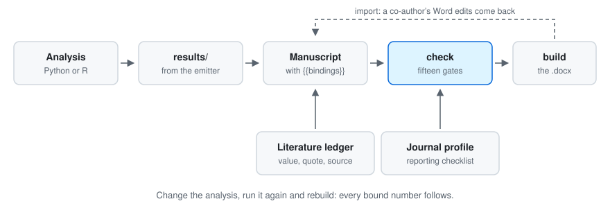
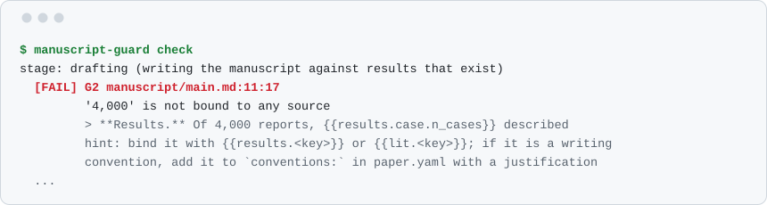

# manuscript-guard

[](https://github.com/BasileChretien/manuscript-guard/actions/workflows/ci.yml)
[](pyproject.toml)
[](LICENSE)
[](#status)

**Make every number in a scientific manuscript traceable to its source.**

A number in a paper comes from one of three places: your results, the literature, or a
convention of scientific writing. `manuscript-guard` holds a manuscript to that. Numbers
from your analysis are bindings into a results file that your code writes, numbers from the
literature are bindings into a ledger backed by stored sources, and anything else has to be
justified. Change the analysis, run it again and rebuild, and every bound number in the
manuscript and the supplement follows. A number with no source is a finding of the check,
not something left for a reviewer to notice.

<picture>
  <source media="(prefers-color-scheme: dark)" srcset="docs/img/loop-dark.svg">
  
</picture>

It is a command line tool written in Python, for a manuscript written in Markdown and built
to a Word document, or written in LaTeX and compiled to a PDF ([LaTeX
manuscripts](docs/latex.md)). The checks are deterministic code: they run offline and in CI and give
the same answer every time. No gate asks a model anything. Two of them read a recorded
review, of each figure and of the manuscript, which a person or a model may have written:
the record is what the gate reads, and a person answers its major findings
([principles](docs/principles.md)). Skills and hooks for Claude Code, Codex and other agent
tools are optional, and help with the parts that need judgement.

## What it catches

Each row names the stage from which its finding fails the run. Before that stage the
finding is printed and counted, and the run passes: a new project starts at `design`,
where the manuscript can wait ([stages](docs/stages.md)).

| What went wrong | What `check` names | Fails from |
|---|---|---|
| A number was typed into the text where a result should be bound | the number, with its line and column | `drafting` |
| A results file was edited by hand | the file, which no longer matches what the analysis wrote | `analysis` |
| The script that wrote a results file, or an input it declared, changed afterwards | which of them, and the script to run again | `analysis` |
| A value taken from a paper is not in the sentence quoted as evidence for it | the value and the quote; the quote itself has to be in the stored source | `drafting` |
| A number was typed into text that a figure draws | the line of the figure's script | `drafting` |
| A threshold or software version the analysis declares was typed into the Methods | the number, with its line and column, and the binding to write | `drafting` |
| The analysis declares a parameter and never reads it | the parameter | `analysis` |
| A model does not suit its variables: a binary outcome under a linear model, a categorical code entered as one slope, a reference other than the one declared, a level with no events | the model and the variable | `analysis` |
| The analysis changed after the Methods were last read against it | the files that changed | `internal-review` |
| A marked step of the code, or the Methods text pointing at it, changed after the two were read together | the step and the paragraph to read again | `internal-review` |
| The Methods point at a step the run never took | the anchor, with its line | `design` |
| A reporting checklist item (STROBE, CONSORT, PRISMA and others) is not addressed | each item still open | `internal-review` |
| The journal's word limit, a required section or a required statement is missed | which one | `internal-review` |
| A reply to a reviewer claims a revision that was not made | the point | `submission` |
| A number sits in TeX that Word would silently drop | the piece of TeX and its line, where pandoc is installed; `build` refuses it too | `drafting` |

`check` knows that a results file is out of date from digests: of the script that wrote
it, and of the inputs that script declared. It does not follow imports, so a change in a
helper module fails the run only where the script lists that module among its `inputs`.
Left unlisted, a source file under `analysis/` that is newer than the results gets a
warning, and the run passes.
`manuscript-guard verify` asks the other question. It runs the analysis again into a
scratch copy and compares every value, which takes as long as the analysis does, and is
what catches a result that changed while its file did not.

This is the finding for the first of those, on the worked example, after one binding in
the abstract was replaced by the number it stood for. The line that opens the output and
what follows the finding are left out:

<picture>
  <source media="(prefers-color-scheme: dark)" srcset="docs/img/check-dark.svg">
  
</picture>

And for the second, after one value in a results file was changed by hand. `...` stands
for a line left out, and other findings follow from the same edit:

```text
  [FAIL] G1 results/01_disproportionality.json
         01_disproportionality.json has been modified since the analysis wrote it
         ...
         hint: results are machine-written; change the analysis and re-run it rather than editing this file
```

## How it works

The manuscript source is Markdown. Numbers appear in it as bindings:

```markdown
The database contained {{results.cohort.n_reports}} reports, of which
{{results.cohort.n_drug_reports}} named example-drug. The reporting odds ratio was
{{results.ror.point}} (95% CI {{results.ror.ci_low}} to {{results.ror.ci_high}}).
```

A table or a figure is placed by its key, `{{table.baseline}}`, and pointed at by it:
`{{ref.table.baseline}}` prints "Table 2" if it is the second table the main text places,
and the number follows the table when it moves.

Your analysis publishes those values through an emitter, which records where they came
from. There is one for Python and one for R, and anything that can write JSON can take part:

```python
from manuscript_guard.emit import Emitter

em = Emitter(__file__, inputs=["data/reports.csv"])
em.value("cohort.n_reports", 4000)
em.value("ror.point", 3.4211, digits=2)
em.write()
```

Then two commands do most of the work:

```bash
manuscript-guard check     # every gate, against the source
manuscript-guard build     # the .docx, with live Zotero citations
```

`check` reads the **source**, where a binding is still visible, and not the rendered text,
where every number looks alike. The rule is short: in manuscript source, a bare number is a
defect unless it is a recognised convention (a 95% confidence interval) or a pointer
(Table 1). The check also runs the other way: a value the analysis declares as quoted,
which nothing quotes, fails too.

`build` writes the .docx from the Markdown every time, so the document is never edited and
nothing is carried across by hand. With Zotero open it writes live Zotero citation fields
that Word's plugin adopts. Without it, `--offline` formats the citations from a committed
`references.bib`, which is what CI and a co-author without your library get.

## What is checked

| Gate | Checks |
|---|---|
| G0 | the manuscript can be read: each source is UTF-8, and it is written in one format, Markdown or LaTeX (`main.md` or a `main.tex` that declares its class), with no Markdown file in a LaTeX manuscript; on a LaTeX manuscript, each gate not yet taught LaTeX says it read nothing, a note that fails at submission |
| G1 | results are as the analysis wrote them, and the script that wrote them and the inputs it declared have not changed since, an input Git LFS or git-annex keeps judged by its pointer where it is not fetched; an input the data custodian keeps is not in git; no result quoted from synthetic data at submission, unless the paper is a demonstration; a dataset's extraction date is pinned to the files the results were computed from; a warning where a lockfile pinning its packages has |
| G2 | every number is classified, in the manuscript and in the replies to the reviewers, every declared value is quoted, every pointer to a table or figure placed by its binding names one the document places, and one the build numbers (`{{ref.table.<key>}}`) a display it can number, and a caption beside a table or figure names that one, and a p value, a share or an interval is quoted with what it belongs to; the level written beside an interval and the label beside a standard deviation or error are the ones emitted (warnings); a unit written after a binding is the one emitted; a day emitted as a date is printed as that day or a coarser statement of it, and a date of the data typed into the analysis rather than declared with its data is warned of; no bound count is printed below the data custodian's minimum |
| G3 | numbers in a figure's output *and in its source* trace back to results, and a script that estimates, samples or draws at random while it plots says why (a warning); each figure placed has alternative text, its numbers bound as prose's are (a warning, and a failure at submission where the journal requires it); the colours it paints, read from its SVG or PDF, stay apart for readers with protanopia, deuteranopia or tritanopia (a warning) and in grey (a note, a warning where the journal prints in grey) |
| G4 | word counts, required sections and required statements match the target journal, and each rule of its profile is quoted from the journal's stored page, its rules no gate checks signed off by the corresponding author, the Data availability statement says what the journal's data policy asks, it or a Code availability statement names the DOI of the package `package` wrote once `paper.yaml` gives it (a failure at submission), and the figure files meet its artwork rules, an SVG's or a PDF's smallest text and thinnest line at the width it prints and a PDF's fonts among them, and the journal chosen from `journals/shortlist.yaml` is indexed for MEDLINE and, if open access, listed in DOAJ, as `lookup --journals` recorded, and the citation style it names is kept unchanged for the offline build and numbers citations as the profile says, and the Data availability statement names the dataset `design/data_sources.yaml` chose and says it is reached as that record says (warnings) |
| G5 | every reporting-checklist item is addressed, or excluded with a reason, and a declared study design has one of its guidelines; a guideline its authors have replaced is pointed out |
| G6 | model artefacts, unfilled placeholders and a journal template's instructions, in the prose, the figures, the tables' captions and the cited references; words to the reviewers or to a model left in the manuscript; AI phrasing; and unsupported appeals to authority |
| G7 | citations resolve and are pinned; every literature quote is in its source, and every value in its quote (with fewer than four words beside it, a warning); a quotation of four words or more in a sentence that cites a work is looked for in its stored source (a warning where it is not there, a note where no source can be read); a passage `literature/passages.yaml` records as supporting a cited sentence is in the cited work's stored source, and belongs to a sentence the manuscript still has (a note where it does not), a person's judgement that it does not support its sentence fails from internal-review, and the cited sentences with no passage are counted (a warning from internal-review); each method `design/methods_review.yaml` records from a similar study is in that study's stored copy (failing from the analysis stage); each reference's DOI, PMID, PMCID, ISBN and arXiv identifier is well formed and its required fields are there; from the records `lookup` keeps, no cited work is retracted, each DOI and PMID names the work cited, a reference with neither is found by its title in PubMed, Crossref or OpenAlex (its identifiers then offered in a note), and the people a reference names are those the registries list for the work (some of them missing, or the first not first, a warning), and no work is cited under two keys; a value the ledger says is a mean of whole numbers can be one of its n (a warning); a passage of twelve words or more that an earlier output of the same authors has too (`literature/related.yaml`, compared on this machine with its stored copy) is named with its part of the paper, a note in Methods that cite the output, in a statement the journal asks for, or where the output is a preprint, abstract or protocol of this study, elsewhere a warning from internal-review |
| G8 | one quantity is not emitted twice under two names, a family of p values says how it is corrected, a number the abstract or a conclusion gives is one the paper reports, and the arithmetic the analysis declares between its results holds: a sum, a difference, a ratio, an order, and each stage of a flow less its exclusions; a P printed after a t, F, chi-squared or z follows from it, an estimate stands inside its confidence interval and a ratio at its middle on the log scale, and an interval and its P agree about the null (warnings); a number an earlier output of the same data printed otherwise, with no reason the manuscript gives, and an overlap of data and authors not disclosed (warnings, failures at submission); a model, a section of the plan, a variable of the data dictionary or the study period the earlier output had otherwise (a warning) |
| G9 | the analysis has not changed since the Methods, the main text's and the supplement's, were last read against it, and, step by step, neither a marked step nor the text pointing at it has |
| G10 | every figure has a current review by someone who looked at it |
| G11 | a recorded panel has reviewed the manuscript, its major findings are answered, every comment a co-author left in Word is answered, and no reading or filed comment was changed after it was sealed |
| G12 | there was an analysis plan, its sections say something, and so do those its declared study design needs; while it is written the data were counted (a warning), a change to it after the first results is said under Deviations, each result its Planned results section lists by key is emitted and quoted, or the Deviations say why not (a warning), a design round's readings are of the plan as it stands, with their major findings answered (a warning until submission), and a data dictionary, where there is one, reads as its schema and its references say (a failure where it does not), defines every variable the plan names in backticks, and holds no entry that the plan, a reporting item or a reason does not need (a warning); the record of the datasets considered, `design/data_sources.yaml`, backs each access claim with a quote on its stored page or the person who said it, the plan names the dataset chosen, a dataset the analysis declares with `dataset()` is one the record chose, and its custodian's minimum cell count and ban on sending are declared in `paper.yaml` (warnings, the last failing from internal review); each appraisal of a similar study's method names a published standard and its domain, each decision to take it is a person's (failing from the analysis stage), and a method taken is cited in the plan with its standard (a warning); each registration `paper.yaml` lists is given in the manuscript, known to its registry, made before the study started and before the first results or said to be retrospective, and each registered outcome is quoted in the registry's words and role, reported as a planned result or its absence said under Deviations (a warning until submission) |
| G13 | every reviewer point is answered, every claimed revision really happened, a quoted revision is new, and nothing in a reply should not reach the journal |
| G14 | an abbreviation is defined once, before it is used, the manuscript keeps to the terms its author declared, it is spelt in one English, a P value, an interval and a percentage are each written one way, and prose in a script the gates do not read is said (warnings only) |
| G15 | each model is the model its variables call for: the outcome is one its kind of model is for, each variable entered as the kind it was declared, with its declared reference and levels, the fit converged with events at every level, the rows of one declared unit are not taken as independent, a crude and an adjusted model were fitted on the same rows, a Poisson model of a binary outcome has a robust variance, and the Methods name the model that was fitted |
| G16 | where the project keeps a data dictionary: each variable the analysis declares or a model reads has an entry (a warning); the data were held to it, each entry and each rule counted by the emitter's `check_data` (a warning from the analysis stage); and the Methods or the supplement bind one of the counts, so that a reader sees what the data held (a warning from drafting); the last two fail at submission |

In place of a gate, a finding can carry one of two labels that are no gate of their own:
`G0`, for a file of the project that cannot be used as it stands, and `BUILD`, for what
the build would refuse or warn of.

`check` ends by grouping what it did by what it is about: computational reproducibility,
numerical provenance, reporting completeness, methodological validity, the data, the
literature, the review, and the language. For each it says which gates checked it and what they found, what
was recorded and by whom and when (a run of `verify`, a panel's reading, a figure review, a
value attested), and in words what no gate decides, such as whether the design supports the
conclusion. There is no score: a single number would be read as "the paper is right", which
no part of this says.

You do not have to satisfy every gate on the first day. Each finding declares the stage at
which it starts to matter, from `design` to `submission`, and until then it is printed and
counted without failing the run: see [stages](docs/stages.md). What each gate guarantees and
why it is built that way is in [principles](docs/principles.md).

## The part no gate can check

Every gate above asks whether a number is the number the analysis produced, or whether a quote
is really in the stored source. None can ask what a reader of that source asks: **does the
sentence say what the document says.** A value can be right, its quote can be right, and the
sentence around it can still name the wrong denominator, subgroup or year with every check
passing. On the first manuscript written with this toolkit, that is what happened, and a
co-author reading one item against one quote is what found it.

```bash
manuscript-guard checker build --all                    # one file per author, to send each
manuscript-guard checker import --answers a.json b.json # what they said, into checks/decisions.csv
manuscript-guard checker status                         # outstanding, stale, and who disagrees
```

`build` writes **one file**. It carries every item, the sentences each value appears in, and the
evidence rendered into the file itself: images as data URIs, tables and excerpts as data. It
opens by double-clicking, in any current browser, offline — nothing installed, no account, no
network,
and nothing sent anywhere by the page. The person presses a button and sends back the answers
file.

What is asked is found from the project's own files: the values quoted from the literature with
the passage each came from, the sentences that cite something, with the passage of the cited
work recorded as supporting each where there is one, each Methods text beside the code of the
steps it points at (and each Methods paragraph pointing at none, as "no code is linked to this
text"), the references, and the authors. A Methods item is answered "Text matches the code",
"Text needs changing", "Code needs changing" or "Not sure".
A number transcribed from a table in a source document is not among them and cannot be — only
the project knows which row it came from — so a project that traces its own numbers adds them in
`checks/items.json`.

A group the project fills, it fills alone: one contributed item in a group means none of the
toolkit's are added to it, since the two are keyed differently and a co-author would otherwise
read the same value twice.

Every answer carries the digest of the item as its maker saw it. If the sentence or the value
moved after they looked, the answer does **not** count as agreement: their yes was about text
nobody has now, and the item is outstanding again. Each page carries the name it was built for
and a token whose digest `checks/bundles.csv` keeps, so a file that names a page and does not
match it is refused; one from no page this project built is recorded as claimed. `checks/decisions.csv` is append-only, because
"was this checked, by whom, and when" is a question asked months later, by whoever is answering a
reviewer.

What this gives you is a record of who looked, at what exactly, when, and what they said. It is
not a proof that they read it correctly, and nothing here checks their reading.

## Install

Python 3.10 or later:

```bash
pip install manuscript-guard
manuscript-guard --version
```

To build a .docx you also need [pandoc](https://pandoc.org/installing.html). Zotero, R, and
`pdftotext` or pypdf for reading PDFs, are needed only for particular things, and the tool
says which when you reach it. [Installing and upgrading](docs/install.md) has the table of
optional tools, the upgrade commands, how to install from the repository, and the R
emitter.

## Quick start

Start a paper:

```bash
manuscript-guard init my-paper
```

That writes a project with a `paper.yaml`, an analysis plan to fill in, a manuscript and an
`AGENTS.md` that gives any agent working there the rules on one page.

Or run the worked example first. [`example/`](example/) is a synthetic pharmacovigilance
study that exercises every gate but G13, having no revision round. It is in the repository and not in the installed package,
so it needs a clone, a Python that has `manuscript_guard` installed, and matplotlib for its
figure:

```bash
git clone https://github.com/BasileChretien/manuscript-guard
cp -r manuscript-guard/example my-example && cd my-example
python analysis/00_simulate.py && python analysis/01_disproportionality.py && python figures/forest.py
manuscript-guard check
manuscript-guard build --offline     # writes build/manuscript.docx and build/supplementary.docx
```

Then type a number over one of the bindings in `manuscript/main.md` and run `check` again.
A different matplotlib version draws a slightly different figure, and `check` then lists
the figure's recorded review as stale; that is `INFO` until the `internal-review` stage.

When a finding surprises you, `manuscript-guard explain manuscript/main.md` prints every
number in the file and the rule that classified it.

## Commands

### Setup & Guide

| Command | What it does |
|---|---|
| `init` | scaffold a new manuscript project; `--latex` starts the manuscript in LaTeX; `--from paper.docx` brings a paper written in Word in, its tables as pipe tables and its title page set aside; `--english en-GB` or `en-US` declares the paper's English (none unless told) |
| `next` | say what to do now, from one run of every gate: what stops a gate, stale results, the plan, the choices due (journal, English, reporting guideline, study design), the numbers' sources, the other failures, the warnings, the next stage, then the optional steps; each with its skill and the exact command, and a choice as the `set` commands to pick from. Writes nothing; `--json` for an agent ([docs/next.md](docs/next.md)) |
| `set` | write one setting of `paper.yaml` (`stage`, `target_journal`, `english_variant`, `reporting_guideline`, `study_type`) and keep its comments and every other line; it refuses, writing nothing, where the file would read back as anything else |
| `stages` | what each stage means and what binds at it |
| `journal` | list journal profiles, start one from the annotated template, or read a journal's page again against the stored one (`--reread`) |
| `style` | fetch the journal's citation style from the CSL style repository once, and keep it in `profiles/journals/styles/` for the offline build |
| `install-skills` | copy the skills to a folder an agent tool reads; `--verify` checks the copy, `--remove` takes it away |

### Checking & Audit

| Command | What it does |
|---|---|
| `check` | run every gate; `--stage submission` holds the manuscript to submission standards |
| `audit` | check a paper that was not written this way, in Word, Markdown or LaTeX: its numbers against the outputs `--against` names, if any, and against each other, its words (G6, G14) and its reference list (G7); `--lookup` asks the registries about each DOI and PMID |
| `explain` | show how each number in a file was classified |
| `bind` | show every unbound number and how to give it a source; `--pointers` offers the `{{ref.…}}` binding that prints each typed "Table 2" |
| `impact` | list what depends on a file, or on each file changed since a commit: results, the sentences that bind them, figures, Methods paragraphs, panel readings and co-author answers |
| `reworded` | check that an edit changed the wording and no binding, citation or typed number, and warn where it made a sentence claim more, less or the opposite |
| `methods` | check or record that the Methods were read against the code; `--explain` lists each claim beside the step that backs it |
| `checklist` | write the completion file for a checklist |
| `fetch` | download a reporting guideline's own checklist document |
| `transcribe` | build checklist profiles from those documents |

### Analysis & Data

| Command | What it does |
|---|---|
| `verify` | re-run the analysis and check it still produces the recorded results |
| `values` | write a LaTeX manuscript's values file, `mgvalues.sty`, so that the `.tex` compiles with the results' numbers in it |
| `models` | print each fitted model as its card, with what G15 says of it |
| `dictionary` | write the data dictionary out for whoever builds the form: REDCap's data dictionary (`--redcap`), one row per variable (`--csv`), or the form's outline in Markdown (`--outline`) |
| `palettes` | list the palettes shipped (MetBrewer, MoMAColors, NatParksPalettes, PNWColors, wesanderson, Okabe-Ito, ColorBrewer, viridis, cividis, Crameri's), with how many colours of each stay apart for readers with a colour-vision deficiency, or show one with its licence |
| `related` | compare the paper with the earlier outputs of the same data in `literature/related.yaml`, value by value; `--take` copies an earlier project's results, plan and data dictionary in, at the revision the author names |

### Literature

| Command | What it does |
|---|---|
| `lookup` | look up each cited DOI and PMID once, search PubMed, Crossref and OpenAlex by its title for a reference with neither, and keep what the registries said in `literature/lookups/`; `--journals` asks the NLM Catalog and DOAJ about each shortlisted journal's ISSN; `--registrations` asks ClinicalTrials.gov, the EU PAS register, OSF or ISRCTN about each registration `paper.yaml` lists, and keeps the answer in `design/registrations/` |
| `search` | ask PubMed, Europe PMC and OpenAlex for works a claim could cite, each with its identifiers, kind, retraction status, later version and open copy; it proposes, the author chooses, and nothing is written |
| `sync-bib` | rewrite `references.bib` from Zotero |
| `sync-sources` | copy each cited work's PDF or saved page from Zotero into `literature/sources/`, or Zotero's text of it where the file is not on this computer or is an EPUB, and list the works with no copy; `--from` takes the PDFs of a folder named by DOI instead, as a downloader such as auto-paper-harvester saves them |
| `passages` | list each sentence that cites a work, with the passage of that work recorded as supporting it and what G7 found of it; `--missing` lists those with none |

### Co-Authors & Review

| Command | What it does |
|---|---|
| `review` | show where the review panel stands; `--run` has it read by the models you list, `--seal` seals a reading written by hand, `--design` does the same for a design round, which reads the plan; `--suggestions` writes the edits a round's findings suggest into a Word document as tracked changes, for you to accept or refuse there and `import` |
| `checker` | send a co-author one file of things to confirm, and record what they answered |
| `import` | bring a co-author's Word edits back into the manuscript source, and file each of their Word comments as a finding to answer |
| `respond` | open a revision round, or write the point-by-point response |
| `approve` | record an author's approval of the manuscript as it stands, which `submit` holds to the manuscript sent; the author's own act |
| `sign` | record a named person's sign-off of a finding only they may close, a G15 warning for the statistician `authors.yaml` names, the journal's rules no gate checks for the corresponding author, a model provider the manuscript may be sent to for the data custodian; that person's own act |

### Build, Release & Communicate

| Command | What it does |
|---|---|
| `render` | substitute the bindings and stop there |
| `build` | produce the .docx, or for a LaTeX manuscript the PDF, compiled with latexmk in a copy; `--annotated` colours every number by what backs it; `--marked-up` also writes the revision, and its supplement, with every change since the documents the journal received shown as Word tracked changes, or highlighted (`--highlight`); `--latex` writes a Markdown manuscript as LaTeX, holds its digits to the Markdown's, and compiles it |
| `submit` | assemble the submission pack, with a checklist of the journal's rules no gate checks, and at a revision of a manuscript packed as Word the marked-up copy beside it; a LaTeX manuscript's source, or with `--latex` a Markdown one's, in one folder that compiles alone |
| `package` | write the package to deposit for reproducibility (Zenodo, OSF, a journal's repository): the scripts, the results and their digests, what they ran with, a README on running them again, CITATION.cff and the results the paper binds; an input goes in only when declared synthetic or shareable, never a restricted one; it uploads nothing; `--citation` adds `.zenodo.json`, `--ro-crate` describes the package as an RO-Crate stating only the links its files show to hold, the rest in RELATIONS.md, with the model cards, `--root-citation` writes the citation files at the project's root where none is, and `--companion` adds one self-contained page of the findings and the evidence for each, made from the records |
| `deposit` | stage a bundle for Zenodo, its sandbox, OSF, arXiv, medRxiv or a GitHub Pages site in `build/deposit/`, with an archive that is the same bytes from the same files: the analysis plan (`preregistration`, refused once results were written from it unless `--retrospective` says why), the package with its crate, its companion page and a VERIFICATION.md of how it was checked (`release`, refused while `check --stage submission` fails), or the paper (`preprint`: the LaTeX source as a `.tar.gz` for arXiv, the documents for medRxiv, each with a sheet of what the form asks); the data custodian's checks come first, a small count, a restricted input and, where they restrict sending, their sign-off of the bundle; it sends and pushes nothing |
| `proof` | compare the publisher's proof (PDF, JATS XML, HTML or text) with the document in the submission pack, table cell by cell, and its title page with `authors.yaml`; list each changed number, sign, decimal mark, unit, citation, reference, name or affiliation, and each part left out, with its page and line, as corrections to send; nothing is sent |

Each takes `--help`. `verify` is a separate command because it executes your analysis, which
a gate never does, and because it takes as long as the analysis does.

## Agent tools

The pip package is the whole guarantee and needs nothing else. An agent tool adds two
things: skills, for the parts that need judgement, and hooks, which catch a mistake at the
moment it is made. [Agent tools](docs/agent-tools.md) says what each tool enforces and what
it does not.

### The Claude Code plugin

This repository is its own plugin marketplace:

```bash
claude plugin marketplace add BasileChretien/manuscript-guard
claude plugin install manuscript-guard@manuscript-guard
```

Twenty skills. Start with `project-setup`; most of the others name the finding codes that
should send you to them.

| Skill | For |
|---|---|
| `project-setup` | starting a paper project, and the daily loop from analysis to .docx |
| `results-binding` | publishing values from the analysis, and turning a red number into a bound one |
| `analysis-plan` | writing the plan before the analysis, and recording deviations from it |
| `data-sources` | the datasets that could answer the question, how each is reached and on what terms, chosen by the author |
| `data-dictionary` | deciding what a study collects, one defined entry per variable, held to the plan |
| `methods-review` | the methods of studies of the same question, judged against published standards, and what the plan takes from them |
| `manuscript-writing` | prose that reads as written |
| `methods-writer` | Methods that describe the code that was actually run |
| `literature-verify` | a number from a paper, with its verbatim quote and stored source |
| `figure-review` | looking at a rendered figure and recording what was seen |
| `figure-design` | a figure's look and palette, chosen with the author, readable by every reader |
| `journal-profile` | choosing a journal with the author, and encoding its rules |
| `reporting-checklist` | STROBE, CONSORT, PRISMA and the rest, retrieved rather than remembered |
| `review-panel` | an internal review panel, recorded and answered |
| `co-author-checking` | the question no gate can ask, put to a person who can answer it |
| `related-outputs` | the earlier abstract, preprint or article on the same data: its numbers compared, its differences explained, the overlap disclosed |
| `word-roundtrip` | a co-author's Word edits, back into the source |
| `reviewer-response` | the point-by-point response to a journal, checked against the revision |
| `submission-pack` | everything the journal asks for, and the covering letter |
| `paper-audit` | a paper that was not written with this toolkit |

Five hooks: one line on the project's state when a session starts, and again at the end of
a turn that changed the manuscript or what it rests on; a refusal to edit files that are
machine-written; a note on the numbers just saved in a manuscript file; and the submission
check before a command that looks like a submission.

### Codex

Codex installs the same plugin, with the same skills and hooks:

```bash
codex plugin marketplace add BasileChretien/manuscript-guard
codex plugin add manuscript-guard@manuscript-guard
```

By Codex's documentation, it runs a hook only after you have trusted it, under `/hooks`.

### Gemini CLI, Mistral Vibe, Kimi Code CLI and other tools

By their own documentation these read skills from a folder, and one command copies the
sixteen there:

```bash
manuscript-guard install-skills              # for you, in every project: ~/.agents/skills
manuscript-guard install-skills --project    # for one paper: .agents/skills in that project
```

There are no hooks under these tools. `check`, `build` and `submit` hold as they do
everywhere.

| | Skills | Hooks |
|---|---|---|
| Claude Code | plugin | four |
| Codex | plugin | four, once you have trusted them |
| Gemini CLI, Mistral Vibe, Kimi Code CLI | copy | none |

## More

| | |
|---|---|
| [Installing and upgrading](docs/install.md) | upgrades, optional tools, the R emitter |
| [Stages](docs/stages.md) | which findings bind when, from the analysis plan to submission |
| [What to do next](docs/next.md) | `next`: the order it decides in, and its JSON for an agent |
| [Principles](docs/principles.md) | what the check guarantees, and why it is built this way |
| [Agent tools](docs/agent-tools.md) | Claude Code, Codex and the others: installing, updating, what each enforces |
| [A review panel read by several models](docs/review-panel.md) | internal review by people, an agent, or models from several providers |
| [LaTeX manuscripts](docs/latex.md) | writing in LaTeX, or sending a Markdown manuscript as LaTeX, and what does not read LaTeX yet |
| [Depositing the code and the results](docs/deposit.md) | the package, its citation files, its description as an RO-Crate, its companion page, and the bundles `deposit` stages |
| [Auditing a paper you already wrote](docs/audit.md) | one command for a manuscript with no bindings, how little a match means, and bringing a Word paper into a project |
| [DESIGN.md](DESIGN.md) | the architecture, the reasons for its decisions, and the known gaps |
| [ATTRIBUTION.md](ATTRIBUTION.md) | the reporting guidelines' licences, and the one data file derived from another work |
| [SECURITY.md](SECURITY.md) | reporting a vulnerability, and what is in scope |

## Status

Alpha. No real manuscript has been through it yet, its author's or anyone else's: `check`,
`build`, `import` and `review --run` have run on the worked example and the test suite's
inputs only. `audit`, which reads a paper written some other way, has been pointed at one
submitted paper, and what it found is recorded in DESIGN.md. G7's reference checks were
measured on 2026-10-21 against the 740 references of 16 published open-access pharmacology
and epidemiology papers: as published, 1.49 false alarms per 100 references in all,
of which 0.68 from the search by title and the comparison of authors; 1.08
from those two with every DOI and PMID taken out, so that each reference was searched for
(DESIGN.md, "Measured on real papers"). What it claims rests on its
tests and on the measurements recorded in [DESIGN.md](DESIGN.md), under "What a claim rests
on". The gates still change from week to week: interfaces, file formats and what a gate
reports can change without a migration path. Every round of review so far has found
something the round before had opened up.

A passing `check` means that no finding due at the project's stage is open. At
`submission` that is what the tables above describe; at an earlier stage the findings not
yet due are printed and counted, and the run still passes. Neither is evidence that a
paper is right. What the toolkit cannot see is listed under "Known gaps" in
[DESIGN.md](DESIGN.md), because a gate whose limits are undocumented gets trusted beyond
them.

The most useful contribution now is a case where a gate is wrong, in either direction:
[CONTRIBUTING.md](CONTRIBUTING.md) says how.

## Citing

If you use manuscript-guard for a paper, the "Cite this repository" button on GitHub gives
the reference, from [CITATION.cff](CITATION.cff).

## Licence

MIT.
