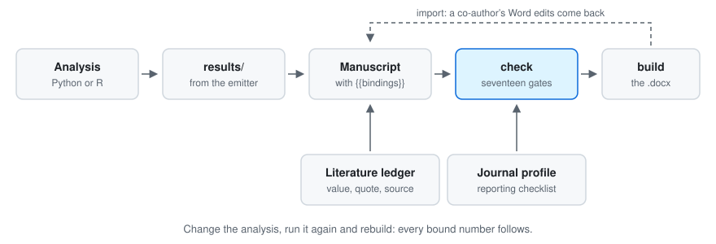
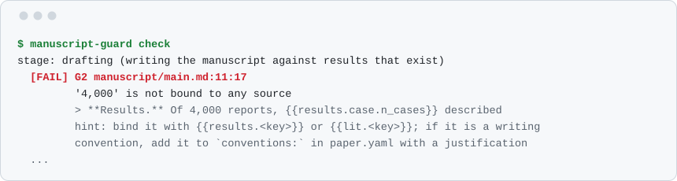

# manuscript-guard

[](https://github.com/BasileChretien/manuscript-guard/actions/workflows/ci.yml)
[](pyproject.toml)
[](LICENSE)
[](#status)

**From research idea to a reproducible, submission-ready manuscript:
AI assistance, human oversight, deterministic checks.**

manuscript-guard is an AI-assisted environment for scientific
research and manuscript production. It helps researchers go from a
research idea to a reproducible, submission-ready manuscript, with
human oversight and deterministic quality assurance throughout.

An agent can do much of the work; a person makes the calls; no check
asks a model anything, and everything runs without an agent. It keeps
a record of the scientific judgements made: it does not make them.

It keeps a study to its record, from the analysis plan to the published paper. The plan is
written before the analysis and frozen when the first results are written. Every number in
the manuscript is bound to the result or the published sentence it came from, or justified
as a convention of writing. The analysis can be run again and its results compared value by
value. The checks and approvals that need a person are recorded, with who gave them and
when, for a co-author, an editor or a reader to look at later.

It holds the study to the guidelines it answers to, each read from its source rather than
remembered: the reporting checklist of its design (CONSORT 2025, SPIRIT 2025, STROBE,
RECORD, PRISMA 2020, TRIPOD+AI and others), the journal's instructions for authors, ICMJE's
recommendations, the study's registration and the norms on text recycling. Each is checked
on every run from the first draft, so what a guideline asks is found while there is still
time to do it, not the night before submission ([the guidelines](#the-guidelines-it-answers-to)).

Claude Code, Codex or another agent tool, with a skill for each step, drafts the plan,
writes and runs the analysis, binds the numbers, drafts the prose and fixes what the check
finds, and `manuscript-guard next` tells it, or you, what to do now. The seventeen gates are
deterministic code that runs offline and in CI; two of them read a recorded review, of each
figure and of the manuscript, which a person or a model may have written
([principles](docs/principles.md)). What only a person should do is put to a person: an
author's approval, a statistician's sign-off, an attestation that a value was read in its
source, sending the manuscript to a model provider, releasing what an analysis wrote from the
data, publishing a deposit. Co-authors are asked, one page each, what no gate can see:
whether a sentence says what its source says.

Numbers are where it is strictest. A number in a paper comes from one of three places: your
results, the literature, or a convention of scientific writing. A number from your analysis
is a binding into a results file that your Python or R code writes; a number from the
literature is a binding into a ledger, beside the sentence of the stored source it was quoted
from; anything else has to be justified. Change the analysis, run it again and rebuild, and
every bound number in the paper and its supplement follows. A number with no source is a
finding of the check, not something left for a reviewer to notice.

> **What it rests on so far.** It is alpha.
>
> - **A real paper.** One manuscript, a narrative review by the toolkit's author, has been
>   through `check`, `build`, `verify`, which ran the analysis again and reproduced each of
>   its 1,483 values, and `import` of two rounds of edits made in Word, by script rather
>   than by a co-author.
> - **A measured set.** G7's reference checks, on the 740 references of 16 published
>   open-access pharmacology and epidemiology papers: as published, 1.49 false alarms per
>   100 references in all, of which 0.68 from the search by title and the comparison of
>   authors; 1.08 from those two with every DOI and PMID taken out.
> - **Not measured.** How much of a study an agent can carry with it, and whether the
>   research is better for it. No study has yet gone from its plan to publication with the
>   toolkit.
>
> [Status](#status) has the rest.

On the worked example: one binding of the abstract replaced by the number it stood for,
`check` failing on it, the number bound again, and `check` passing.

<picture>
  <source media="(prefers-color-scheme: dark)" srcset="docs/img/demo-dark.svg">
  
</picture>

## Two ways in

**I have a manuscript.** `audit` checks a paper written some other way: its numbers against
each other and against the analysis outputs you give it, its Abstract against its Results,
its words and its reference list. The [audit page](docs/audit-page.md) runs it on a .docx in
a web browser, and the paper is not uploaded; the page goes live with the next release.
<!-- TODO(after 0.2.476): link https://basilechretien.github.io/manuscript-guard/ here once it answers. -->
At a terminal, with [uv](https://docs.astral.sh/uv/) and nothing else installed:

```bash
uvx manuscript-guard audit paper.docx
```

**I am starting a project.**

```bash
pip install manuscript-guard
manuscript-guard init my-paper
cd my-paper
manuscript-guard next
```

`init` writes the project, and `next` says what to do now, with the command to run, from the
analysis plan on. [Install](#install) has what else a build needs, and
[Quick start](#quick-start) the worked example.

## Who it is for

Guided, not replaced: three kinds of user, using the same tool differently.

- **PhD students and researchers new to a step.** `manuscript-guard next` and the skills walk
  you through each step and say what each check asks. The methods still need a supervisor's
  or a statistician's judgement, and the tool records their sign-off.
- **Experienced researchers.** Less copying of numbers and checking by hand; the analysis
  reruns (`verify`); co-authors stay in Word (`import`).
- **PIs and research groups.** The same stages and checks across a group's papers; a GitHub
  Action that runs them in each paper's repository (in progress); and the records of who
  approved what.

## Who does what

| Who | What |
|---|---|
| An agent, through the skills | drafts the analysis plan, writes and runs the analysis, binds the numbers, drafts the prose, fixes what `check` finds |
| The gates | decide from the records, offline and in CI, and ask no model anything |
| A person | answers the findings only a person may close, among them: an attestation that a value was read in its source, a judgement that a passage supports its sentence, an answer to a co-author's comment or to a major finding of a review; approves the manuscript (`approve`); signs off what is theirs to close (`sign`); answers a co-author's page of things to confirm (`checker`); is asked before the manuscript is sent to a model provider (`review --run`) and before a deposit is published (`deposit --publish`) |

## What it covers

- **The plan and the data.** An analysis plan, a data dictionary, the record of the datasets
  considered and the one chosen, the study's registration; the data held, where need be, in
  a folder the operating system keeps from the agent, with a synthetic copy to write the code
  against ([the vault](docs/vault.md)).
- **The analysis.** Results published by an emitter for Python or R, with the scripts and
  inputs they came from, or taken in from what a script writes on its own
  ([harvest](docs/harvest.md)); models held to their variables; `verify` runs it all again.
- **The manuscript.** Markdown built to Word, or LaTeX compiled to a PDF
  ([LaTeX](docs/latex.md)); tables and figures placed by key and numbered by the build; live
  Zotero citations.
- **The check.** Seventeen gates, from the numbers to the Methods against the code, the
  references, the figures, the journal's rules ([journal profiles](docs/journal-profiles.md)),
  the reporting checklist and the language. A finding fails from the stage at which it
  starts to matter ([stages](docs/stages.md)), and `next` says what to do about it
  ([what to do next](docs/next.md)).
- **Co-authors and review.** Edits and comments in Word brought back to the source
  ([co-authors](docs/co-authors.md)); a review panel of people, or of models from several
  providers ([review panel](docs/review-panel.md)); replies to the journal's reviewers held
  to the revision.
- **Submission and after.** The submission pack, the publisher's proof checked against it,
  the code and results packaged and deposited at Zenodo or OSF ([deposit](docs/deposit.md)),
  posts and summaries held to the paper ([communicate](docs/communicate.md)).
- **Other people's papers.** `audit` and `compare` read a manuscript written some other way,
  a PDF among them, on your own computer: an editor's or a referee's
  ([refereeing](docs/refereeing.md)), or your own from before ([audit](docs/audit.md)).

<picture>
  <source media="(prefers-color-scheme: dark)" srcset="docs/img/loop-dark.svg">
  
</picture>

## What it catches

Each row names the stage from which its finding fails the run. Before that stage the
finding is printed and counted, and the run passes: a new project starts at `design`,
where the manuscript can wait ([stages](docs/stages.md)).

| What went wrong | What `check` names | Fails from |
|---|---|---|
| A number was typed into the text where a result should be bound | the number, with its line and column | `drafting` |
| A results file was edited by hand | the file, which no longer matches what the analysis wrote | `analysis` |
| The script that wrote a results file, or an input it declared, changed afterwards | which of them, and the script to run again | `analysis` |
| A value taken from a paper is not in the sentence quoted as evidence for it | the value and the quote; the quote itself has to be in the stored source | `drafting` |
| A cited work has been retracted | the reference, and the registry that says so, from what `lookup` recorded | `drafting` |
| A DOI or PMID names another work than the one cited | the reference, and what the registry has under it | `internal-review` |
| A number was typed into text that a figure draws | the line of the figure's script | `drafting` |
| A model does not suit its variables: a binary outcome under a linear model, a categorical code entered as one slope, a reference other than the one declared, a level with no events | the model and the variable | `analysis` |
| The analysis changed after the Methods were last read against it | the files that changed | `internal-review` |
| A count below the data custodian's minimum is printed | the count and its key | `internal-review` |
| A reporting checklist item (CONSORT, STROBE, PRISMA and others) is not addressed | each item still open | `internal-review` |
| The journal's word limit, a required section or a required statement is missed | which one | `internal-review` |
| A co-author's comment in Word has no answer | the comment, by its file and line or by its words | `submission` |
| A registered outcome is reported nowhere, and the Deviations do not say why | the registration and the outcome | `submission` |
| A reply to a reviewer claims a revision that was not made | the point | `submission` |

`check` knows that a results file is out of date from digests: of the script that wrote
it, and of the inputs that script declared. It does not follow imports, so a change in a
helper module fails the run only where the script lists that module among its `inputs`.
Left unlisted, a source file under `analysis/` that is newer than the results gets a
warning, and the run passes.
`manuscript-guard verify` asks the other question. It runs the analysis again into a
scratch copy and compares every value, which takes as long as the analysis does, and is
what catches a result that changed while its file did not.

This is the finding for the first of those, on the worked example, after one binding in
the abstract was replaced by the number it stood for. The line that opens the output and
what follows the finding are left out:

<picture>
  <source media="(prefers-color-scheme: dark)" srcset="docs/img/check-dark.svg">
  
</picture>

And for the second, after one value in a results file was changed by hand. `...` stands
for a line left out, and other findings follow from the same edit:

```text
  [FAIL] G1 results/01_disproportionality.json
         01_disproportionality.json has been modified since the analysis wrote it
         ...
         hint: results are machine-written; change the analysis and re-run it rather than editing this file
```

## The guidelines it answers to

| Guideline | What is checked | Gate |
|---|---|---|
| Reporting checklists: CONSORT 2025, SPIRIT 2025, STROBE, RECORD, RECORD-PE, PRISMA 2020, TRIPOD+AI, STARD 2015, CHEERS 2022, ARRIVE 2.0, READUS-PV, and SANRA for a narrative review | each item says where it is addressed, or why it does not apply; a warning where the study design declared has none of its guidelines, and where a guideline's authors have replaced it | G5 |
| The journal's instructions for authors | each rule quoted from the journal's stored page: limits, sections, required statements, the data availability statement against the data policy, artwork, the boxes beside the abstract | G4 |
| ICMJE's recommendations | tables and figures cited in the order of their first citation; an earlier output of the same data disclosed | G2, G8 |
| The study's registration, at ClinicalTrials.gov, the EU PAS register, OSF or ISRCTN | made before the study started, or said to be retrospective; each registered outcome reported in the registry's words and role, or its absence said | G12 |
| Text recycling (Text Recycling Research Project; COPE and BioMed Central) | passages shared with the authors' earlier papers, with the part of the paper each is in | G7 |
| Methods standards: the ENCePP Guide, target trial emulation, ROBINS-I, RoB 2, PROBAST+AI, ROBIS and others | a method taken from a similar study is appraised against one, and taken on a person's decision | G12 |
| The data custodian's rules | no count printed below the custodian's minimum; a restricted input never packaged | G2, `package` |

**How it keeps up.** A checklist is downloaded from its authors' site (`fetch`) and turned
into items by a recipe (`transcribe`), never typed from memory; a new edition is a new
recipe, and the items are made again from the new document. A journal's page read again
(`journal --reread`) shows which rules changed. `check` lists each item still open at every
run, so the checklist is kept from the first draft rather than filled in at the end. How much
time this saves has not been measured.

**What it does not do.** G5 holds that each item names a place or a reason, and warns where
the place is no heading of the manuscript; whether the text there does what the item asks is for a reader, and the starter
panel of a review round has a reporting-guideline reviewer for it. The checklists are not shipped, since each has its own licence:
`fetch` and `transcribe` make each one once, on your machine. [The guidelines](docs/guidelines.md)
has each row in full.

## How it works

The manuscript source is Markdown. Numbers appear in it as bindings:

```markdown
The database contained {{results.cohort.n_reports}} reports, of which
{{results.cohort.n_drug_reports}} named example-drug. The reporting odds ratio was
{{results.ror.point}} (95% CI {{results.ror.ci_low}} to {{results.ror.ci_high}}).
```

A value from a paper is bound the same way, `{{lit.background.class_ror}}`, to an entry of
`literature/ledger.yaml` that holds the value, the sentence it was quoted from and the stored
copy of the source. A table or a figure is placed by its key, `{{table.baseline}}`, and
pointed at by it: `{{ref.table.baseline}}` prints "Table 2" if it is the second table the
main text places, and the number follows the table when it moves. In LaTeX the binding is
`\mg{results.cohort.n_reports}` ([LaTeX manuscripts](docs/latex.md)).

Your analysis publishes those values through an emitter, which records where they came
from. There is one for Python and one for R, and anything that can write JSON can take part:

```python
from manuscript_guard.emit import Emitter

em = Emitter(__file__, inputs=["data/reports.csv"])
em.value("cohort.n_reports", 4000)
em.value("ror.point", 3.4211, digits=2)
em.write()
```

An output a script writes on its own, a `.csv`, `.tsv` or `.json`, is taken in by
`harvest` ([harvest](docs/harvest.md)).

Then three commands do most of the work:

```bash
manuscript-guard next      # what to do now, with the command to run
manuscript-guard check     # every gate, against the source
manuscript-guard build     # the .docx, with live Zotero citations
```

`check` reads the **source**, where a binding is still visible, and not the rendered text,
where every number looks alike. The rule is short: in manuscript source, a bare number is a
defect unless it is a recognised convention (a 95% confidence interval) or a pointer
(Table 1). The check also runs the other way: a value the analysis declares as quoted,
which nothing quotes, fails too.

`build` writes the .docx from the Markdown every time, so the document is never edited and
nothing is carried across by hand. With Zotero open it writes live Zotero citation fields
that Word's plugin adopts. Without it, `--offline` formats the citations from a committed
`references.bib`, which is what CI and a co-author without your library get.

## What is checked

| Gate | Checks |
|---|---|
| G0 | the manuscript can be read: each source is UTF-8, and it is written in one format, Markdown or LaTeX (`main.md` or a `main.tex` that declares its class), with no Markdown file in a LaTeX manuscript; on a LaTeX manuscript, each gate not yet taught LaTeX says it read nothing, a note that fails at submission |
| G1 | results are as the analysis wrote them, and the script that wrote them and the inputs it declared have not changed since, an input Git LFS or git-annex keeps judged by its pointer where it is not fetched; an input the data custodian keeps is not in git; no result quoted from synthetic data at submission, unless the paper is a demonstration; a dataset's extraction date is pinned to the files the results were computed from; a warning where a lockfile pinning its packages has |
| G2 | every number is classified, in the manuscript and in the replies to the reviewers, every declared value is quoted, every pointer to a table or figure placed by its binding names one the document places, and one the build numbers (`{{ref.table.<key>}}`) a display it can number, and a caption beside a table or figure names that one, and a p value, a share or an interval is quoted with what it belongs to; the level written beside an interval and the label beside a standard deviation or error are the ones emitted (warnings); a unit written after a binding is the one emitted; a day emitted as a date is printed as that day or a coarser statement of it, and a date of the data typed into the analysis rather than declared with its data is warned of; no bound count is printed below the data custodian's minimum, nor held back ("<5") beside a sum the analysis declares that gives it away (a warning beside a table's total or a column's header n) |
| G3 | numbers in a figure's output *and in its source* trace back to results, and a script that estimates, samples or draws at random while it plots says why (a warning); each figure placed has alternative text, its numbers bound as prose's are (a warning, and a failure at submission where the journal requires it); the colours it paints, read from its SVG or PDF, stay apart for readers with protanopia, deuteranopia or tritanopia (a warning) and in grey (a note, a warning where the journal prints in grey) |
| G4 | word counts, required sections and required statements match the target journal, and each rule of its profile is quoted from the journal's stored page, its rules no gate checks signed off by the corresponding author, the Data availability statement says what the journal's data policy asks, it or a Code availability statement names the DOI of the package `package` wrote once `paper.yaml` gives it (a failure at submission), that DOI is no test DOI of Zenodo's sandbox (a failure at every stage), and is the one `deposit/receipts/` records for the release once it is published (a failure at submission), the boxes it prints beside the abstract (highlights, key points) are in the main text and within its limits (a warning, and a failure at submission where the journal requires the box), and the figure files meet its artwork rules, an SVG's or a PDF's smallest text and thinnest line at the width it prints and a PDF's fonts among them, and the journal chosen from `journals/shortlist.yaml` is indexed for MEDLINE and, if open access, listed in DOAJ, as `lookup --journals` recorded, and the citation style it names is kept unchanged for the offline build and numbers citations as the profile says, and the Data availability statement names the dataset `design/data_sources.yaml` chose and says it is reached as that record says (warnings) |
| G5 | every reporting-checklist item is addressed, or excluded with a reason, and a declared study design has one of its guidelines; a guideline its authors have replaced is pointed out |
| G6 | model artefacts, unfilled placeholders and a journal template's instructions, in the prose, the figures, the tables' captions and the cited references; words to the reviewers or to a model left in the manuscript; AI phrasing; and unsupported appeals to authority |
| G7 | citations resolve and are pinned; every literature quote is in its source, and every value in its quote (with fewer than four words beside it, a warning); a quotation of four words or more in a sentence that cites a work is looked for in its stored source (a warning where it is not there, a note where no source can be read); a passage `literature/passages.yaml` records as supporting a cited sentence is in the cited work's stored source, and belongs to a sentence the manuscript still has (a note where it does not), a person's judgement that it does not support its sentence fails from internal-review, and the cited sentences with no passage are counted (a warning from internal-review); each method `design/methods_review.yaml` records from a similar study is in that study's stored copy (failing from the analysis stage); each reference's DOI, PMID, PMCID, ISBN and arXiv identifier is well formed and its required fields are there; from the records `lookup` keeps, no cited work is retracted, a cited work with a later version (a new version or edition at Crossref, an "Update in" at PubMed) is a warning and one corrected since a note, a number the ledger quotes from a work PubMed types only as an editorial or a comment is a warning, and from one it types only as a review a note (letters are not read), each DOI and PMID names the work cited, a reference with neither is found by its title in PubMed, Crossref or OpenAlex (its identifiers then offered in a note), and the people a reference names are those the registries list for the work (some of them missing, or the first not first, a warning), and no work is cited under two keys; a sentence that says one thing affects or causes another, with no hedge, and cites only works PubMed types as case reports, editorials, letters or comments, is a note; each claim in the scope of reference currency (marked in `literature/currency.yaml`, or citing a work whose lookup record shows a later version or a published preprint) has a decision, by fixed rules from two readings or by a named person (a warning from internal-review, a failure at submission where `paper.yaml` sets `references.currency: required`), a decision by the rules is the one they give from the readings, each reading's quotes are in the work's stored abstract or text, a proposed change is answered by a person, or taken by citing the work it proposes (a warning, a failure at submission), a search more than six months old is a warning (a failure at submission), and no work a decision keeps or proposes is retracted; a value the ledger says is a mean of whole numbers can be one of its n (a warning); a passage of twelve words or more that an earlier output of the same authors has too (`literature/related.yaml`, compared on this machine with its stored copy) is named with its part of the paper, a note in Methods that cite the output, in a statement the journal asks for, or where the output is a preprint, abstract or protocol of this study, elsewhere a warning from internal-review |
| G8 | one quantity is not emitted twice under two names, a family of p values says how it is corrected, a number the abstract, a conclusion or a box the journal prints beside the abstract gives is one the paper reports, and the arithmetic the analysis declares between its results holds: a sum, a difference, a ratio, an order, and each stage of a flow less its exclusions; a P printed after a t, F, chi-squared or z follows from it, an estimate stands inside its confidence interval and a ratio at its middle on the log scale, and an interval and its P agree about the null (warnings); a number an earlier output of the same data printed otherwise, with no reason the manuscript gives, and an overlap of data and authors not disclosed (warnings, failures at submission); a model, a section of the plan, a variable of the data dictionary or the study period the earlier output had otherwise (a warning) |
| G9 | the analysis has not changed since the Methods, the main text's and the supplement's, were last read against it, and, step by step, neither a marked step nor the text pointing at it has |
| G10 | every figure has a current review by someone who looked at it |
| G11 | a recorded panel has reviewed the manuscript, its major findings are answered, every comment a co-author left in Word is answered, and no reading or filed comment was changed after it was sealed |
| G12 | there was an analysis plan, its sections say something, and so do those its declared study design needs; while it is written the data were counted (a warning), a change to it after the first results is said under Deviations, each result its Planned results section lists by key is emitted and quoted, or the Deviations say why not (a warning), a design round's readings are of the plan as it stands, with their major findings answered (a warning until submission), and a data dictionary, where there is one, reads as its schema and its references say (a failure where it does not), defines every variable the plan names in backticks, and holds no entry that the plan, a reporting item or a reason does not need (a warning); the record of the datasets considered, `design/data_sources.yaml`, backs each access claim with a quote on its stored page or the person who said it, the plan names the dataset chosen, a dataset the analysis declares with `dataset()` is one the record chose, and its custodian's minimum cell count and ban on sending are declared in `paper.yaml` (warnings, the last failing from internal review); each appraisal of a similar study's method names a published standard and its domain, each decision to take it is a person's (failing from the analysis stage), and a method taken is cited in the plan with its standard (a warning); each registration `paper.yaml` lists is given in the manuscript, known to its registry, made before the study started and before the first results or said to be retrospective, and each registered outcome is quoted in the registry's words and role, reported as a planned result or its absence said under Deviations (a warning until submission) |
| G13 | every reviewer point is answered, every claimed revision really happened, a quoted revision is new, and nothing in a reply should not reach the journal |
| G14 | an abbreviation is defined once, before it is used, the manuscript keeps to the terms its author declared, it is spelt in one English, a P value, an interval and a percentage are each written one way, and prose in a script the gates do not read is said (warnings only) |
| G15 | each model is the model its variables call for: the outcome is one its kind of model is for, each variable entered as the kind it was declared, with its declared reference and levels, the fit converged with events at every level, the rows of one declared unit are not taken as independent, a crude and an adjusted model were fitted on the same rows, a Poisson model of a binary outcome has a robust variance, and the Methods name the model that was fitted |
| G16 | where the project keeps a data dictionary: each variable the analysis declares or a model reads has an entry (a warning); the data were held to it, each entry and each rule counted by the emitter's `check_data` (a warning from the analysis stage); and the Methods or the supplement bind one of the counts, so that a reader sees what the data held (a warning from drafting); the last two fail at submission |

In place of a gate, a finding can carry one of two labels that are no gate of their own:
`G0`, for a file of the project that cannot be used as it stands, and `BUILD`, for what
the build would refuse or warn of.

`check` ends by grouping what it did by what it is about: computational reproducibility,
numerical provenance, reporting completeness, methodological validity, the data, the
literature, the review, and the language. For each it says which gates checked it and what they found, what
was recorded and by whom and when (a run of `verify`, a panel's reading, a figure review, a
value attested), and in words what no gate decides, such as whether the design supports the
conclusion. There is no score: a single number would be read as "the paper is right", which
no part of this says.

You do not have to satisfy every gate on the first day. Each finding declares the stage at
which it starts to matter, from `design` to `submission`, and until then it is printed and
counted without failing the run: see [stages](docs/stages.md). What each gate guarantees and
why it is built that way is in [principles](docs/principles.md).

## The part no gate can check

Every gate above asks whether a number is the number the analysis produced, or whether a quote
is really in the stored source. None can ask what a reader of that source asks: **does the
sentence say what the document says.** A value can be right, its quote can be right, and the
sentence around it can still name the wrong denominator, subgroup or year with every check
passing. On the first manuscript written with this toolkit, that is what happened, and a
co-author reading one item against one quote is what found it.

```bash
manuscript-guard checker build --all                    # one file per author, to send each
manuscript-guard checker import --answers a.json b.json # what they said, into checks/decisions.csv
manuscript-guard checker status                         # outstanding, stale, and who disagrees
manuscript-guard checker recap                          # who checked what, into checks/recap.md
```

`checker build` writes one file for each person, which opens in any current browser, offline,
with nothing installed and nothing sent anywhere by the page. It asks about the values quoted
from the literature, the sentences that cite something, each Methods text beside the code it
points at, the references and the authors. Each answer carries the digest of what its maker
saw, so an answer about a sentence that has changed since no longer counts as agreement, and
`checker recap` writes who checked what, tamper-evident by an unsigned hash chain over the
record. What this gives you is a record of who looked, at what exactly, when, and what they
said. It is not a proof that they read it correctly, and nothing here checks their reading.

The rest of a co-author's part is in Word. `import` brings their edits back into the source
and files each of their comments as a finding to answer; `review --suggestions` writes the
edits a panel's findings suggest into a Word document as tracked changes, for the author to
accept or refuse; `approve`
records an author's approval of the manuscript as it stands; and `build --marked-up` writes
the revision with every change since the version the journal received.
[Working with co-authors](docs/co-authors.md) has the detail of each.

## Install

Python 3.10 or later:

```bash
pip install manuscript-guard
manuscript-guard --version
```

To audit one paper without installing anything, [uv](https://docs.astral.sh/uv/) runs it in
one line, fetching a Python if there is none:

```bash
uvx manuscript-guard audit paper.docx
```

Or, with no terminal at all, [the audit page](docs/audit-page.md) runs `audit` on a .docx in
a web browser, and the paper is not uploaded.

To build a .docx you also need [pandoc](https://pandoc.org/installing.html). Zotero, R, and
`pdftotext` or pypdf for reading PDFs, are needed only for particular things, and the tool
says which when you reach it. [Installing and upgrading](docs/install.md) has the table of
optional tools, the upgrade commands, how to install from the repository, and the R
emitter.

## Quick start

Start a paper:

```bash
manuscript-guard init my-paper
```

That writes a project with a `paper.yaml`, an analysis plan to fill in, a manuscript and an
`AGENTS.md` that gives any agent working there the rules on one page.

Or run the worked example first. [`example/`](example/) is a synthetic pharmacovigilance
study that exercises every gate but G13, having no revision round. It is in the repository and not in the installed package,
so it needs a clone, a Python that has `manuscript_guard` installed, and matplotlib for its
figure:

```bash
git clone https://github.com/BasileChretien/manuscript-guard
cp -r manuscript-guard/example my-example && cd my-example
python analysis/00_simulate.py && python analysis/01_disproportionality.py && python figures/forest.py
manuscript-guard check
manuscript-guard build --offline     # writes build/manuscript.docx and build/supplementary.docx
```

Then type a number over one of the bindings in `manuscript/main.md` and run `check` again.
A different matplotlib version draws a slightly different figure, and `check` then lists
the figure's recorded review as stale; that is `INFO` until the `internal-review` stage.

When a finding surprises you, `manuscript-guard explain manuscript/main.md` prints every
number in the file and the rule that classified it.

## Commands

### Setup & Guide

| Command | What it does |
|---|---|
| `init` | scaffold a new manuscript project; `--latex` starts the manuscript in LaTeX; `--from paper.docx` brings a paper written in Word in, its tables as pipe tables and its title page set aside; `--english en-GB` or `en-US` declares the paper's English (none unless told) |
| `next` | say what to do now, from one run of every gate: what stops a gate, stale results, the plan, the choices due (journal, English, reporting guideline, study design), the numbers' sources, the other failures, the warnings, the next stage, then the optional steps; each with its skill and the exact command, and a choice as the `set` commands to pick from. Writes nothing; `--json` for an agent ([docs/next.md](docs/next.md)) |
| `set` | write one setting of `paper.yaml` (`stage`, `target_journal`, `english_variant`, `reporting_guideline`, `study_type`) and keep its comments and every other line; it refuses, writing nothing, where the file would read back as anything else |
| `stages` | what each stage means and what binds at it |
| `journal` | list journal profiles, start one from the annotated template, or read a journal's page again against the stored one (`--reread`, and `--page` for a block's page of its own) |
| `style` | fetch the journal's citation style from the CSL style repository once, and keep it in `profiles/journals/styles/` for the offline build |
| `install-skills` | copy the skills to a folder an agent tool reads; `--verify` checks the copy, `--remove` takes it away |
| `report-issue` | write a report of a failure of the tool's own (`--last`, a fingerprint, `--list`) or about a gate or a command that got something wrong (`--about G2 --flagged` or `--missed`, with the text that shows it, checked again on this machine for `audit`, G6 and G14, and a test to start from), or of anything else (`--title`), print it whole and give the issue page's address with it filled in, for you to read and post; the error's message only with `--with-message`; it sends nothing ([docs/failures.md](docs/failures.md)) |

### Checking & Audit

| Command | What it does |
|---|---|
| `check` | run every gate; `--stage submission` holds the manuscript to submission standards |
| `audit` | check a paper that was not written this way, in Word, Markdown or LaTeX, or a PDF through `pdftotext` (each place a page and a line, its tables read as text): its numbers against the outputs `--against` names, if any, and against each other, a flow printed as a list, its Abstract against its Results, its words (G6, G14) and its reference list (G7); `--lookup` asks the registries about each DOI and PMID; for an editor, `--journal` holds the main document to the journal's profile, lists what a .docx holds besides its text, and with `--authors` finds an author named in any document given where the review is blind and with `--lookup` counts the authors' and the journal's own references; for a referee, `--design observational` warns of a causal claim where the paper sums up, and `--cited FILE` lists each citation beside its sentence, with each work's abstract under `--lookup`; `--package` holds the authors' package (.zip or folder, unpacked safely) to its own MANIFEST.yaml, each result to the script packaged beside it, and the paper's numbers to its results, and runs nothing; `--report-draft FILE.md` writes the findings and their places, and what was not checked, as the start of your report ([docs/refereeing.md](docs/refereeing.md)) |
| `compare` | for an editor or a referee, set a revised manuscript beside the version before it, a PDF among them: the sections, the tables cell by cell (not in a PDF), the numbers, citations and bindings gone, new or changed, the sentences that claim more, less or the opposite, and the revision audited with each finding marked new or standing; `--response` holds the letter's quotations to both versions, and `--comments` matches your own comments by what they quote or name; `--report-draft FILE.md` writes the findings and their places as the start of your report; it sends nothing, and never says a comment was answered ([docs/refereeing.md](docs/refereeing.md)) |
| `explain` | show how each number in a file was classified |
| `bind` | show every unbound number and how to give it a source; `--pointers` offers the `{{ref.…}}` binding that prints each typed "Table 2" |
| `impact` | list what depends on a file, or on each file changed since a commit: results, the sentences that bind them, figures, Methods paragraphs, panel readings and co-author answers |
| `reworded` | check that an edit changed the wording and no binding, citation or typed number, and warn where it made a sentence claim more, less or the opposite |
| `methods` | check or record that the Methods were read against the code; `--explain` lists each claim beside the step that backs it |
| `checklist` | write the completion file for a checklist |
| `fetch` | download a reporting guideline's own checklist document |
| `transcribe` | build checklist profiles from those documents |

### Analysis & Data

| Command | What it does |
|---|---|
| `verify` | re-run the analysis and check it still produces the recorded results, a harvested output among them; `--receipt SITE`, run where the data are held, runs each harvest entry naming the site and writes `receipts/SITE.receipt.json` of what ran and what came out, by digest, refused where an output holds a count the custodian forbids, and warning where a total may give one away |
| `harvest` | take in an output a script writes without the emitter (`.csv`, `.tsv`, `.json`) as `results/<key>.json`, its cells as values and its table as `table.<key>`, by `harvest.yaml`, with the columns that are counts (`--counts`) and a table that is working output (`--not-quoted`); it runs nothing, so `check` warns until `verify` or a site's receipt covers it ([docs/harvest.md](docs/harvest.md)) |
| `vault` | register the folder where the data are held, outside the project, which the operating system keeps from the agent: `init FOLDER FILE...` records each file named by its digest in `design/vault.yaml` and the folder's path in a git-ignored local file, refused for a folder inside the project or a `paper.yaml` with no custodian's minimum cell count, and prints Claude Code's deny rules for the folder (`--agent-settings` writes them, after asking you); `check` says whether this session can read the data, exit 0 not reachable, 1 readable, 2 not registered here; the plugin's hooks say so at each session start, and refuse an agent's command that names the folder while it can be read; `init` also starts `analysis/00_profile.py`, whose `em.profile` writes each file's profile, every count below the minimum held back and any a reader could work out from the rest, no centile the smallest or largest value; `run [SCRIPT...]`, at a terminal, lists the scripts changed since the run released last, asks, runs them on the data in a copy of the project inside the vault and keeps what they wrote in its outbox, the agent told only exit codes and where a script failed; `release RUN --as PERSON`, at a terminal, holds every count of the outbox to the custodian's minimum, releases a file no check reads only where you type its path, and records the release; `synthesize [NAME]` draws `data/synthetic/NAME` from the released profile, the data dictionary and a kept seed, and from nothing else, as CSV or TSV; it sends nothing, and a released file is read by the agent and its provider ([docs/vault.md](docs/vault.md)) |
| `values` | write a LaTeX manuscript's values file, `mgvalues.sty`, so that the `.tex` compiles with the results' numbers in it |
| `models` | print each fitted model as its card, with what G15 says of it |
| `dictionary` | write the data dictionary out for whoever builds the form: REDCap's data dictionary (`--redcap`), one row per variable (`--csv`), or the form's outline in Markdown (`--outline`) |
| `palettes` | list the palettes shipped (MetBrewer, MoMAColors, NatParksPalettes, PNWColors, wesanderson, Okabe-Ito, ColorBrewer, viridis, cividis, Crameri's), with how many colours of each stay apart for readers with a colour-vision deficiency, or show one with its licence |
| `related` | compare the paper with the earlier outputs of the same data in `literature/related.yaml`, value by value; `--take` copies an earlier project's results, plan and data dictionary in, at the revision the author names |

### Literature

| Command | What it does |
|---|---|
| `lookup` | look up each cited DOI and PMID once, search PubMed, Crossref and OpenAlex by its title for a reference with neither, and keep what the registries said in `literature/lookups/`; `--journals` asks the NLM Catalog and DOAJ about each shortlisted journal's ISSN; `--registrations` asks ClinicalTrials.gov, the EU PAS register, OSF or ISRCTN about each registration `paper.yaml` lists, and keeps the answer in `design/registrations/`; `--paper` asks Crossref about the paper's own DOI, and keeps the answer in `communication/lookups/` for `communicate check` |
| `search` | ask PubMed, Europe PMC and OpenAlex for works a claim could cite, each with its identifiers, kind, retraction status, later version and open copy; it proposes, the author chooses, and nothing is written |
| `sync-bib` | rewrite `references.bib` from Zotero |
| `sync-sources` | copy each cited work's PDF or saved page from Zotero into `literature/sources/`, or Zotero's text of it where the file is not on this computer or is an EPUB, and list the works with no copy; `--from` takes the PDFs of a folder named by DOI instead, as a downloader such as auto-paper-harvester saves them |
| `passages` | list each sentence that cites a work, with the passage of that work recorded as supporting it and what G7 found of it; `--missing` lists those with none |
| `references` | whether each cited work is still the one to cite: alone, a row for each claim in scope (a sentence and a work it cites that `literature/currency.yaml` marks, or whose lookup record shows a later version or a published preprint) with how far its entry got; `--explain ID` its searches, readings and what the rules give; `--mark "WORDS" @KEY` marks a claim; `--reading FILE` files a reading once, sealed, and writes the rules' decision once two are filed; `--refuse ID --why ... --as PERSON` records a person's refusal of a proposed change. It searches nothing and calls no model |

### Co-Authors & Review

| Command | What it does |
|---|---|
| `review` | show where the review panel stands; `--run` has it read by the models you list, `--seal` seals a reading written by hand, `--design` does the same for a design round, which reads the plan; `--suggestions` writes the edits a round's findings suggest into a Word document as tracked changes, for you to accept or refuse there and `import` |
| `checker` | send a co-author one file of things to confirm, record what they answered, and recap who checked what (`recap`, `recap --check`) |
| `import` | bring a co-author's Word edits back into the manuscript source, and file each of their Word comments as a finding to answer |
| `respond` | open a revision round, or write the point-by-point response |
| `approve` | record an author's approval of the manuscript as it stands, which `submit` holds to the manuscript sent; the author's own act |
| `sign` | record a named person's sign-off of a finding only they may close, a G15 warning for the statistician `authors.yaml` names, the journal's rules no gate checks for the corresponding author, a model provider the manuscript may be sent to for the data custodian; that person's own act |

### Build, Release & Communicate

| Command | What it does |
|---|---|
| `render` | substitute the bindings and stop there |
| `build` | produce the .docx, or for a LaTeX manuscript the PDF, compiled with latexmk in a copy; `--annotated` colours every number by what backs it; `--marked-up` also writes the revision, and its supplement, with every change since the documents the journal received shown as Word tracked changes, or highlighted (`--highlight`); `--latex` writes a Markdown manuscript as LaTeX, holds its digits to the Markdown's, and compiles it |
| `submit` | assemble the submission pack, with a checklist of the journal's rules no gate checks, and at a revision of a manuscript packed as Word the marked-up copy beside it; a LaTeX manuscript's source, or with `--latex` a Markdown one's, in one folder that compiles alone |
| `package` | write the package to deposit for reproducibility (Zenodo, OSF, a journal's repository): the scripts, the results and their digests, what they ran with, a README on running them again, CITATION.cff and the results the paper binds; an input goes in only when declared synthetic or shareable, never a restricted one; it uploads nothing; `--citation` adds `.zenodo.json`, `--ro-crate` describes the package as an RO-Crate stating only the links its files show to hold, the rest in RELATIONS.md, with the model cards, `--root-citation` writes the citation files at the project's root where none is, and `--companion` adds one self-contained page of the findings and the evidence for each, made from the records |
| `deposit` | stage a bundle for Zenodo, its sandbox, OSF, arXiv, medRxiv or a GitHub Pages site in `build/deposit/`, with an archive that is the same bytes from the same files: the analysis plan (`preregistration`, refused once results were written from it unless `--retrospective` says why), the package with its crate, its companion page and a VERIFICATION.md of how it was checked (`release`, refused while `check --stage submission` fails), or the paper (`preprint`: the LaTeX source as a `.tar.gz` for arXiv, the documents for medRxiv, each with a sheet of what the form asks); the data custodian's checks come first, a small count, a restricted input and, where they restrict sending, their sign-off of the bundle; it sends and pushes nothing unless asked: `--reserve-doi` makes a Zenodo draft with its DOI reserved and writes a release's into `paper.yaml` once you say yes, `--stage` sends the bundle to that draft or as a private OSF project, each file's md5 checked, and `--publish` publishes the draft only when the bundle is the one staged and you type its DOI at a terminal; the token is read from the environment, and each answer is kept in `deposit/receipts/` |
| `proof` | compare the publisher's proof (PDF, JATS XML, HTML or text) with the document in the submission pack, table cell by cell, and its title page with `authors.yaml`; list each changed number, sign, decimal mark, unit, citation, reference, name or affiliation, and each part left out, with its page and line, as corrections to send; nothing is sent |
| `communicate` | opt-in (`communication: {enabled: true}` in paper.yaml): `brief` writes `communication/brief.yaml`, the paper's own sentences, quoted, that every communication of it restates, with the primary finding for you to mark; `graphical-abstract` draws two concepts of a graphical abstract from it as SVG, at the journal's size, in Okabe and Ito's colours, with their alternative text; `check` holds the brief to the manuscript, and each text under `communication/` and the graphical abstract to the brief and the results: numbers bound, claims anchored and no stronger than the paper's, limitations kept, the publication status, the embargo, the journal's sharing policy, the platform's length; `build` writes each channel's text from the brief (posts and threads, an overview slide, a poster outline, a storyboard, a data announcement, translations), with slots for what only a person or an agent writes (a press release, a pitch, plain-language summaries, a script), and a `preview.html`; `status` says what is due given the publication's status and dates, and `--prepare` writes it; `approve --as <author> <channel>` records an author's approval of a text as it stands; `publish <channel>` writes what it would send to `communication/outbox/`, and with `--post`, which the author runs, posts it to Bluesky or Mastodon once it is checked, approved and past the embargo, with the credentials from the environment, and records what the service answered; LinkedIn is printed to paste and ResearchGate is by hand; `orcid` asks the authors' public ORCID records whether the paper's DOI is on them ([docs/communicate.md](docs/communicate.md)); nothing else sends anything |

Each takes `--help`. `verify` is a separate command because it executes your analysis, which
a gate never does, and because it takes as long as the analysis does.

## Agent tools

The pip package is the whole guarantee and needs nothing else. An agent tool adds two
things: skills, which carry an agent through the steps that need judgement, and hooks,
which catch a mistake at the moment it is made and put to you the calls only you may make.
[Agent tools](docs/agent-tools.md) says what each tool enforces and what it does not.

### The Claude Code plugin

This repository is its own plugin marketplace:

```bash
claude plugin marketplace add BasileChretien/manuscript-guard
claude plugin install manuscript-guard@manuscript-guard
```

Start with `guide`, which works through the paper with its author from `manuscript-guard
next`, and `project-setup`, which starts the project; most of the other skills name the
finding codes that should send you to them.

| Skill | For |
|---|---|
| `guide` | the paper worked through with its author turn by turn, from `manuscript-guard next`: each choice put as numbered options, each step handed to its skill |
| `project-setup` | starting a paper project, and the daily loop from analysis to .docx |
| `results-binding` | publishing values from the analysis, and turning a red number into a bound one |
| `analysis-plan` | writing the plan before the analysis, and recording deviations from it |
| `data-sources` | the datasets that could answer the question, how each is reached and on what terms, chosen by the author |
| `data-dictionary` | deciding what a study collects, one defined entry per variable, held to the plan |
| `methods-review` | the methods of studies of the same question, judged against published standards, and what the plan takes from them |
| `manuscript-writing` | prose that reads as written |
| `methods-writer` | Methods that describe the code that was actually run |
| `literature-verify` | a number from a paper, with its verbatim quote and stored source |
| `figure-review` | looking at a rendered figure and recording what was seen |
| `figure-design` | a figure's look and palette, chosen with the author, readable by every reader |
| `journal-profile` | choosing a journal with the author, and encoding its rules |
| `reporting-checklist` | STROBE, CONSORT, PRISMA and the rest, retrieved rather than remembered |
| `review-panel` | an internal review panel, recorded and answered |
| `co-author-checking` | the question no gate can ask, put to a person who can answer it |
| `related-outputs` | the earlier abstract, preprint or article on the same data: its numbers compared, its differences explained, the overlap disclosed |
| `word-roundtrip` | a co-author's Word edits, back into the source |
| `reviewer-response` | the point-by-point response to a journal, checked against the revision |
| `submission-pack` | everything the journal asks for, and the covering letter |
| `research-communication` | the slots of a post, a press release or a lay summary filled from the paper's brief, with no number or claim the paper does not make |
| `paper-audit` | a paper that was not written with this toolkit |

Five hooks: one line on the project's state when a session starts, ending with what
`manuscript-guard next` puts first, and again at the end of a turn that changed the
manuscript or what it rests on; a refusal to edit files that are machine-written; a note on
the numbers just saved in a manuscript file; and the submission check before a command that
looks like a submission. An author's approval, a named person's sign-off, an attester named
in `literature/attested.yaml` and a panel sent to the models without asking are each put to you before they
run, and refused where nobody can be asked. Where the data are held in a
[vault](docs/vault.md), the session's first line says whether the agent can read them, and a
command that names their folder is refused while it can.

### Codex

Codex installs the same plugin, with the same skills and hooks:

```bash
codex plugin marketplace add BasileChretien/manuscript-guard
codex plugin add manuscript-guard@manuscript-guard
```

By Codex's documentation, it runs a hook only after you have trusted it, under `/hooks`.

### Gemini CLI, Mistral Vibe, Kimi Code CLI and other tools

By their own documentation these read skills from a folder, and one command copies the
skills there:

```bash
manuscript-guard install-skills              # for you, in every project: ~/.agents/skills
manuscript-guard install-skills --project    # for one paper: .agents/skills in that project
```

There are no hooks under these tools. `check`, `build` and `submit` hold as they do
everywhere.

| | Skills | Hooks |
|---|---|---|
| Claude Code | plugin | five |
| Codex | plugin | five, once you have trusted them |
| Gemini CLI, Mistral Vibe, Kimi Code CLI | copy | none |

## More

| | |
|---|---|
| [Installing and upgrading](docs/install.md) | upgrades, optional tools, the R emitter |
| [Stages](docs/stages.md) | which findings bind when, from the analysis plan to submission |
| [The guidelines](docs/guidelines.md) | the reporting checklists, ICMJE, the journal's instructions, the registration, text recycling, methods standards and the custodian's rules: what each check holds, and what it leaves to a reader |
| [Working with co-authors](docs/co-authors.md) | edits and comments in Word, suggested edits as tracked changes, approvals, the marked-up revision, and the checker for what no gate can check |
| [Journal profiles](docs/journal-profiles.md) | the journal's rules quoted from its page: the boxes beside the abstract, a graphical abstract, what may be shared |
| [What to do next](docs/next.md) | `next`: the order it decides in, and its JSON for an agent |
| [Principles](docs/principles.md) | what the check guarantees, and why it is built this way |
| [Agent tools](docs/agent-tools.md) | Claude Code, Codex and the others: installing, updating, what each enforces |
| [A review panel read by several models](docs/review-panel.md) | internal review by people, an agent, or models from several providers |
| [LaTeX manuscripts](docs/latex.md) | writing in LaTeX, or sending a Markdown manuscript as LaTeX, and what does not read LaTeX yet |
| [Depositing the code and the results](docs/deposit.md) | the package, its citation files, its description as an RO-Crate, its companion page, the bundles `deposit` stages, and what it sends to Zenodo and OSF when asked |
| [Communicating the paper](docs/communicate.md) | the brief of the paper's own sentences, the graphical abstract drawn from it, and every post or summary held to both |
| [Auditing a paper you already wrote](docs/audit.md) | one command for a manuscript with no bindings, how little a match means, and bringing a Word paper into a project |
| [For editors and reviewers](docs/refereeing.md) | a manuscript sent in confidence, a PDF among them, read on your own computer with nothing sent: a referee's audit, its causal words and its cited sentences, and an editor's against the journal's profile, its tracked changes and the names Word keeps, the authors named where the review is blind, and the self-citations counted; a revision set beside the version before it, with the response letter; the authors' package held to its own manifest; and a draft of your report with the findings and their places |
| [Data held apart from the agent](docs/vault.md) | the vault: the data in a folder the operating system keeps from the agent, the four setups that do that, most separating first, three traps, what the hooks refuse and what the agent tool's own rules cover; the analysis run on the data in a copy inside the vault, and what it wrote released on a person's word; the profile of each file and the synthetic copy drawn from it |
| [When manuscript-guard itself fails](docs/failures.md) | the one sentence a fault of the tool's own ends in, the record kept on your machine, and the variables that turn it off |
| [Supporting the project](docs/funding.md) | grants, collaborations and GitHub Sponsors, and the contributions that cost no money |
| [DESIGN.md](DESIGN.md) | the architecture, the reasons for its decisions, and the known gaps |
| [ATTRIBUTION.md](ATTRIBUTION.md) | the reporting guidelines' licences, and the one data file derived from another work |
| [SECURITY.md](SECURITY.md) | reporting a vulnerability, and what is in scope |

## Status

Alpha. The gates still change from week to week: interfaces, file formats and what a gate
reports can change without a migration path. Every round of review so far has found
something the round before had opened up.

What has run on real papers:

- **One real manuscript**, a narrative review by the toolkit's author, written with it since
  September 2026. On 2026-11-04, with 0.2.473, it went through `check`, `lookup`, `build`
  (live and offline), `verify`, which ran the analysis again and reproduced each of its
  1,483 values, and `import` of two rounds of edits made in Word 16 as a co-author would make
  them, by script rather than by a co-author. It stopped at the submission check, which asks
  for a review panel.
- **`audit`**, which reads a paper written some other way, has been pointed at one submitted
  paper, and what it found is recorded in DESIGN.md.
- **G7's reference checks** were measured on 2026-10-21 against the 740 references of 16
  published open-access pharmacology and epidemiology papers: as published, 1.49 false
  alarms per 100 references in all, of which 0.68 from the search by title and the
  comparison of authors; 1.08 from those two with every DOI and PMID taken out, so that each
  reference was searched for (DESIGN.md, "Measured on real papers").
- **G6's thresholds** for AI phrasing were set from how often it fires on 384 biomedical
  research articles of 2010 to 2022, written by people; no text written by a model was read.

The rest has run on the worked example and the test suite's inputs only: among it the review
panel (`review --run`), the co-author checker, `submit`, `proof`, `package` and `deposit`,
`communicate`, the vault and `compare`. No study has yet gone from its plan to publication
with the toolkit, and two things have not been measured: how much of a study an agent can
carry with it, and whether the research is better for it. What it claims rests on its tests
and on the measurements recorded in [DESIGN.md](DESIGN.md), under "What a claim rests on".

A passing `check` means that no finding due at the project's stage is open. At
`submission` that is what the tables above describe; at an earlier stage the findings not
yet due are printed and counted, and the run still passes. Neither is evidence that a
paper is right. What the toolkit cannot see is listed under "Known gaps" in
[DESIGN.md](DESIGN.md), because a gate whose limits are undocumented gets trusted beyond
them.

## Contributing without code

The most useful contribution now is a case where a gate is wrong, in either direction: a
false alarm or a miss, reported with the smallest text that shows it. The
[issue templates](.github/ISSUE_TEMPLATE/gate-got-it-wrong.md) ask for that, and
`manuscript-guard report-issue --about G2 --flagged --snippet "…"` (or `--missed`) writes the
report for you to read and post. A profile of a journal you submit to
([journal profiles](docs/journal-profiles.md)) and a recipe for a reporting checklist that
is missing are contributions too.
[CONTRIBUTING.md](CONTRIBUTING.md) says how, and [supporting the project](docs/funding.md)
lists the ways to help, with and without money.

## Citing

If you use manuscript-guard for a paper, the "Cite this repository" button on GitHub gives
the reference, from [CITATION.cff](CITATION.cff).

## Licence

MIT.
