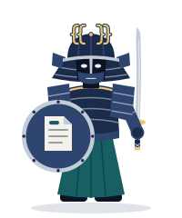
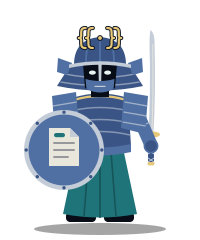
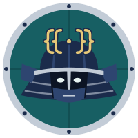
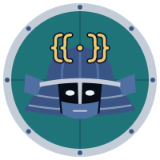
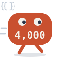
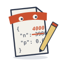
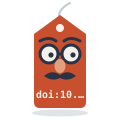
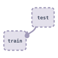

# Vord and the emblem

manuscript-guard's mascot is Vord, a guard who keeps the manuscript. The name is from Old Norse
*vörðr*, a warden. The armour mixes a Japanese helmet with a Norse shield and nasal bar. This
folder holds the drawings and the rules for using them.

- `source.svg` holds every drawing, each a `<symbol>` whose colours are named tokens.
- `python tools/brand_assets.py` writes each drawing to `docs/img/brand/` as a file of its
  own, once for a light page and once for a dark one.
- `python tools/brand_assets.py --png` also renders the PNGs. It needs a local Chrome or Edge;
  set `MANUSCRIPT_GUARD_BROWSER` to its path if it is not found.

`tests/test_brand.py` fails while the files under `docs/img/brand/` differ from what the
script writes, and while the villains' or the shadows' colour comes within 10 of Vord's brass,
teal, navy, plates or steel, or of each other, for a reader with a colour-vision deficiency.

## Vord

| | |
|---|---|
|  |  |

- A kabuto with a flared neck guard and a crest shaped as `{{ }}`, the binding syntax.
- A Norse nasal bar and a half mask. The face stays in the helmet's shadow, so Vord is no one
  in particular.
- A round shield bearing a page, its bound value in teal.
- The katana is held upright at rest. It is never drawn against anyone.

## The emblem

| | |
|---|---|
|  |  |

The emblem is Vord's helmet on a round shield.

- `emblem-light.svg` and `emblem-dark.svg` are for 48 pixels and above.
- `emblem-small-*.svg` is redrawn for 32 pixels and below, with fewer lines and one pair of
  braces, since `{{ }}` blurs into one mark at that size.
- `favicon.svg` and `favicon-32.png` are for a browser tab.
- `emblem-512.png` is for places that take only a PNG.
- `social-preview.png` is the card GitHub shows where the repository is linked. It is
  uploaded by hand under Settings, General, Social preview.

## The banner

<picture>
  <source media="(prefers-color-scheme: dark)" srcset="../docs/img/brand/banner-dark.svg">
  
</picture>

`banner-light.svg` and `banner-dark.svg` are 860 by 240 pixels and loop every 14 seconds:

1. Each villain in turn runs at the manuscript. Vord's shield shows the gate that catches its
   mistake, and the villain fades.
2. The two shadows pass through the shield.
3. The co-author reads the manuscript through a magnifying glass.

The motion is CSS inside the SVG, so it plays in a browser that shows the SVG as an image,
GitHub included, with no script. A renderer that reads the style but not the animation, such
as librsvg in some converters, shows the still frame. So does a browser whose reader asks for
less motion. The still frame is the Stray Number blocked by G2, and the co-author reading.
The order and the timing are
`CAST` and `LOOP` with the constants beside them in `tools/brand_assets.py`. The test holds
each villain's gate in the banner to the gate its drawing's title names.

## What Vord fights

Each villain stands for a mistake that a gate catches, and is named with that gate.

| | Villain | The mistake | Gate |
|---|---|---|---|
|  | The Stray Number | a number typed into the text, bound to nothing | G2 |
|  | The Forger | a results file edited by hand | G1 |
|  | The Ghost Citation | a retracted work, still cited | G7 |
|  | The Impostor DOI | a DOI that names another work than the one cited | G7 |
|  | The Plan Rewriter | the plan changed after the first results, and the Deviations say nothing | G12 |
|  | Stale Methods | the analysis changed since the Methods were last read against it | G9 |

What no gate catches is a shadow. Vord's sword passes through a shadow, so Vord calls the
co-author, who reads what no gate can.

| | Shadow | Why no gate sees it |
|---|---|---|
|  | Confirmation bias | it lies in what the authors chose to look at |
|  | Data leakage | no gate reads the analysis code for test data used in training |
|  | The co-author | the person who reads what no gate can |

A new villain needs a gate that catches its mistake. A mistake no gate catches becomes a
shadow, not a villain, so that the drawings never claim a check the tool does not make.

## Colours

| Token | Light | Dark | On |
|---|---|---|---|
| `g-navy` | `#1b2b4b` | `#3a5585` | armour |
| `g-plate` | `#2e4570` | `#5070a3` | plates, sleeves, shield face |
| `g-teal` | `#175f63` | `#1f7479` | cloth, the bound value, the emblem's shield |
| `g-steel` | `#c3ccd7` | `#c3ccd7` | blade, rims, brim |
| `g-brass` | `#e6c878` | `#e6c878` | crest, sword guard, trim |
| `v-foe` | `#c9502f` | `#d95b36` | the villains |
| `v-shade` | `#9481a7` | `#a093b4` | the shadows |

The full list is `PALETTES` in `tools/brand_assets.py`. The villain's ember and the shadow's
lilac were chosen with `manuscript_guard.colour`, the model G3 holds a figure to: Machado,
Oliveira and Fernandes (2009) at full severity, and CIEDE2000. For protanopia, deuteranopia
and tritanopia alike, each stays at least 10 apart from the brass, teal, navy, plates and
steel of the guard, and from the other. Vord's other colours (dark teal, visor, paper, eye,
ink, the crest's edge and his shadow on the ground) are not compared. Within Vord, steel and
brass become the same grey in print. They are trim on one figure and carry no meaning apart.

## Using the drawings

- Show the light file on a light page and the dark one on a dark page. In Markdown that is a
  `<picture>` with a `prefers-color-scheme: dark` source.
- Keep the proportions. Leave clear space of an eighth of the emblem's width around it.
- Do not recolour Vord or the villains. In particular, never give a villain one of Vord's
  colours.
- Do not draw Vord's sword against a person, and do not add horns or blood.
- Do not put the emblem on a paper, a poster or a slide as a sign that the work was verified
  or approved. A passing `check` is not evidence that a paper is right, and the emblem must not
  say otherwise.

Some drawings carry words: 4,000 on the Stray Number; the Forger's results file (`"n": 3986`,
`"p": 0.04` and the 4000 written over it); RETRACTED; doi:10.; PLAN; Methods and the "z z" of
Stale Methods; and train and test on the data-leakage shadow. These name JetBrains Mono or
Atkinson Hyperlegible first and fall back to system fonts. The words of the social preview
and the gates on the banner's shield name system fonts only. Most readers see all of them in
a system font.

The test holds the SVGs to the source, but not the PNGs, whose pixels depend on the browser
that renders them. After a change to the emblem, run the script with `--png` too, or the PNGs
keep the old drawing.

## Licence

The drawings in this folder and in `docs/img/brand/` are under the
[Creative Commons Attribution 4.0 licence](https://creativecommons.org/licenses/by/4.0/).
Credit them as "Vord and the manuscript-guard emblem, by the manuscript-guard project, CC BY
4.0". The code that writes them, like the rest of the repository, is under the MIT licence.

The drawings were written as SVG code by an AI assistant, Claude, to the author's direction
and choices. Where copyright law gives no right in such a drawing, the licence restricts
nothing.
