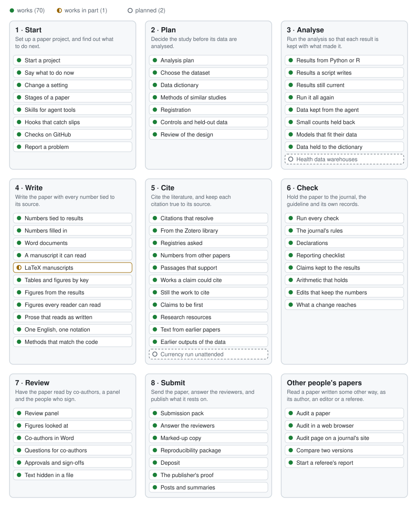

# Features

<!-- Drawn by tools/feature_map.py from docs/features.yaml: edit that file and run
     the script, never this page. -->

Everything manuscript-guard is meant to do, by the stage of a paper it belongs to:
one entry for each thing it promises, what does it, and the tests that prove it.
Of the 80 entries, 75 work, 3 work in part, and 2 are planned.

The source is [features.yaml](features.yaml), which an agent tool reads before it
changes a feature. `python tools/feature_map.py` draws this page and its picture from
it, and `tests/test_features.py` holds them to the package: every command, gate,
skill and hook is in an entry, and every test an entry names is there.

<picture>
  <source media="(prefers-color-scheme: dark)" srcset="img/features-dark.svg">
  
</picture>

## Start

Set up a paper project, and find out what to do next.

| Feature | What it does | Status | Done by | Proved by |
|---|---|---|---|---|
| **[Start a project](getting-started.md)** | Writes a new paper project in Markdown or LaTeX, or brings in a paper already written in Word. | works | [`init`](commands.md#setup--guide), skill [`project-setup`](agent-tools.md) | [`test_scaffold.py`](../tests/test_scaffold.py) [`test_from_word.py`](../tests/test_from_word.py) |
| **[Say what to do now](next.md)** | Runs every check once and says what to do next, with the command to run and the skill that helps. | works | [`next`](commands.md#setup--guide), skill [`guide`](agent-tools.md) | [`test_guide.py`](../tests/test_guide.py) |
| **[Change a setting](commands.md#setup--guide)** | Changes one setting of paper.yaml, such as the stage or the journal, and keeps every other line as it was. | works | [`set`](commands.md#setup--guide) | [`test_set.py`](../tests/test_set.py) |
| **[Stages of a paper](stages.md)** | Says what each stage of a paper means, and from which stage each finding stops the paper. | works | [`stages`](commands.md#setup--guide) | [`test_policy.py`](../tests/test_policy.py) |
| **[Skills for agent tools](agent-tools.md)** | Gives Claude Code, Codex and other agent tools a skill for each step, and copies the skills where a tool reads them. | works | [`install-skills`](commands.md#setup--guide) | [`test_plugin.py`](../tests/test_plugin.py) [`test_skillcopy.py`](../tests/test_skillcopy.py) |
| **[Hooks that catch slips](agent-tools.md)** | In an agent tool, refuses edits to files the tool writes, classifies each number as it is typed, and says where the paper stands when a session starts and a turn ends. | works | hook `guard-write`, hook `after-edit`, hook `session-start`, hook `stop` | [`test_hooks.py`](../tests/test_hooks.py) |
| **[Checks on GitHub](github-actions.md)** | A GitHub workflow runs the checks and the build on each push and pull request of the paper's repository. | works | &mdash; | [`test_github_action.py`](../tests/test_github_action.py) |
| **[Report a problem](failures.md)** | Writes a report of a failure, or of a check that got something wrong, for you to read and post; it sends nothing. | works | [`report-issue`](commands.md#setup--guide) | [`test_report_issue.py`](../tests/test_report_issue.py) [`test_report_about.py`](../tests/test_report_about.py) |

## Plan

Decide the study before its data are analysed.

| Feature | What it does | Status | Done by | Proved by |
|---|---|---|---|---|
| **[Analysis plan](stages.md)** | The plan is written before the analysis, and a change to it after the first results is a deviation the paper has to declare. | works | [G12](gates.md), skill [`analysis-plan`](agent-tools.md) | [`test_corruption.py::test_a_plan_changed_after_the_results_with_nothing_said_is_a_warning`](../tests/test_corruption.py) [`test_corruption.py::test_the_kept_plan_is_never_written_again`](../tests/test_corruption.py) [`test_study_types.py`](../tests/test_study_types.py) [`test_differential.py::test_every_plan_sections_asked_input_holds_each_kind_of_section`](../tests/test_differential.py) [`test_corruption.py::test_a_heading_names_its_section_exactly_whatever_its_words`](../tests/test_corruption.py) |
| **Choose the dataset** | Records the datasets considered, how each is reached and on what terms, and the one the author chose. | works | [G12](gates.md), skill [`data-sources`](agent-tools.md) | [`test_data_sources.py`](../tests/test_data_sources.py) |
| **Data dictionary** | Defines each variable the study collects, held to the plan, and writes the list out for REDCap or a paper form. | works | [`dictionary`](commands.md#analysis--data), [G12](gates.md), skill [`data-dictionary`](agent-tools.md) | [`test_dictionary.py`](../tests/test_dictionary.py) [`test_dictionary_export.py`](../tests/test_dictionary_export.py) [`test_collection.py`](../tests/test_collection.py) |
| **Methods of similar studies** | Judges the methods of studies of the same question against published standards, and records what the plan takes from them. | works | [G7](gates.md), [G12](gates.md), skill [`methods-review`](agent-tools.md) | [`test_methods_review.py`](../tests/test_methods_review.py) |
| **Registration** | Looks the study up in its registry, and holds the outcomes the paper reports to the ones it registered. | works | [`lookup`](commands.md#literature), [G12](gates.md) | [`test_registration_lookup.py`](../tests/test_registration_lookup.py) |
| **Controls and held-out data** | Holds the controls and the held-out data the plan declares to what the analysis did with them, and when. | works | [G1](gates.md), [G12](gates.md) | [`test_declarations.py`](../tests/test_declarations.py) [`test_emit_controls.py`](../tests/test_emit_controls.py) |
| **[Review of the design](review-panel.md)** | Has the plan read before the analysis starts, by people or by models, and asks for each major finding to be answered. | works | [G12](gates.md), skill [`review-panel`](agent-tools.md) | [`test_review_design_run.py`](../tests/test_review_design_run.py) |

## Analyse

Run the analysis so that each result is kept with what made it.

| Feature | What it does | Status | Done by | Proved by |
|---|---|---|---|---|
| **Results from Python or R** | The analysis publishes each result through a small library for Python or R, which keeps the script and the inputs it came from. | works | skill [`results-binding`](agent-tools.md) | [`test_emit.py`](../tests/test_emit.py) [`test_r_emitter.py`](../tests/test_r_emitter.py) |
| **[Results a script writes](harvest.md)** | Takes in a table or a value that a script writes on its own, as CSV, TSV or JSON, as results like the others. | works | [`harvest`](commands.md#analysis--data) | [`test_harvest.py`](../tests/test_harvest.py) |
| **Results still current** | Fails when a result was edited by hand, or when its script or an input changed after it was written. | works | [G1](gates.md) | [`test_corruption.py::test_hand_edited_results_file_is_caught`](../tests/test_corruption.py) [`test_corruption.py::test_modified_analysis_script_is_caught`](../tests/test_corruption.py) [`test_corruption.py::test_changed_input_data_is_caught`](../tests/test_corruption.py) [`test_input_digests.py`](../tests/test_input_digests.py) |
| **Run it all again** | Runs the analysis again, with the R the author names, and checks that it gives the recorded results, value by value, saying which R or Python ran each script. | works | [`verify`](commands.md#analysis--data) | [`test_verify.py`](../tests/test_verify.py) |
| **[Data kept from the agent](vault.md)** | Keeps the data in a folder the operating system keeps from the agent, with a synthetic copy to write the code against. | works | [`vault`](commands.md#analysis--data) | [`test_vault.py`](../tests/test_vault.py) [`test_vault_run.py`](../tests/test_vault_run.py) [`test_vault_synthesize.py`](../tests/test_vault_synthesize.py) |
| **Small counts held back** | Prints no count below the data custodian's minimum, and no total beside a held-back count that gives it away. | works | [G2](gates.md) | [`test_corruption.py::test_a_small_count_held_back_or_written_with_a_point_is_caught`](../tests/test_corruption.py) [`test_margins.py`](../tests/test_margins.py) |
| **Models that fit their data** | Holds each model to its variables: a kind of model the outcome calls for, the references and levels declared, and a fit that converged. | works | [`models`](commands.md#analysis--data), [G15](gates.md) | [`test_models.py`](../tests/test_models.py) |
| **Data held to the dictionary** | Counts each entry and rule of the data dictionary on the data, and asks the Methods to report what the data held. | works | [G16](gates.md) | [`test_quality.py`](../tests/test_quality.py) [`test_r_quality.py`](../tests/test_r_quality.py) |
| **[Health data warehouses](../DESIGN.md#health-data-warehouses-formats-in-the-middle-adapters-at-the-edges)** | Reads the outputs of OMOP, CDISC, SAS and Stata analyses through adapters that a third party can write for its own provider. *Designed on 2026-11-05; nothing is built yet.* | planned | &mdash; | &mdash; |

## Write

Write the paper with every number tied to its source.

| Feature | What it does | Status | Done by | Proved by |
|---|---|---|---|---|
| **Numbers tied to results** | Every number in the text is tied to a result, to a quoted source or to a convention of writing; a number tied to nothing fails. | works | [`bind`](commands.md#checking--audit), [`explain`](commands.md#checking--audit), [G2](gates.md), skill [`results-binding`](agent-tools.md) | [`test_binding.py`](../tests/test_binding.py) [`test_rules.py`](../tests/test_rules.py) |
| **Numbers filled in** | Puts each result's number where the text names it, in Markdown, or through a values file in LaTeX. | works | [`render`](commands.md#build-release--communicate), [`values`](commands.md#analysis--data) | [`test_build.py`](../tests/test_build.py) [`test_latex_values.py`](../tests/test_latex_values.py) |
| **Word documents** | Builds the manuscript and its supplement as Word documents, with live Zotero citations, says why when a citation could not be one, puts the reference list under its heading, and on request every number coloured by what backs it. | works | [`build`](commands.md#build-release--communicate) | [`test_build.py`](../tests/test_build.py) [`test_annotate.py`](../tests/test_annotate.py) [`test_zotero_word.py`](../tests/test_zotero_word.py) [`test_references_heading.py`](../tests/test_references_heading.py) [`test_cli.py::test_an_offline_build_says_its_citations_are_text_and_check_notes_it`](../tests/test_cli.py) |
| **A manuscript it can read** | Each source file is UTF-8, and the manuscript is written in one format, Markdown or LaTeX. | works | [G0](gates.md) | [`test_corruption.py::test_a_number_typed_into_a_file_that_is_not_utf8_is_not_a_pass`](../tests/test_corruption.py) [`test_reader.py`](../tests/test_reader.py) |
| **[LaTeX manuscripts](latex.md)** | Writes and checks the manuscript in LaTeX, compiled to a PDF, or writes LaTeX out of a Markdown manuscript for a journal that asks for it. *A gate not yet taught LaTeX says it read nothing, a note that fails at submission.* | works in part | [G0](gates.md) | [`test_latex_build.py`](../tests/test_latex_build.py) [`test_latex_twin.py`](../tests/test_latex_twin.py) [`test_latex_from_markdown.py`](../tests/test_latex_from_markdown.py) |
| **Tables and figures by key** | Places tables and figures by key, numbers them in the build, and checks that each "Table 2" in the text names one that is there. | works | [G2](gates.md) | [`test_corruption.py::test_a_pointer_to_what_the_document_does_not_carry_is_said`](../tests/test_corruption.py) [`test_latex_pointers.py`](../tests/test_latex_pointers.py) |
| **Figures from the results** | The numbers a figure draws, in its file and in the script that drew it, come from the results. | works | [G3](gates.md) | [`test_figures.py`](../tests/test_figures.py) [`test_placed_figures.py`](../tests/test_placed_figures.py) |
| **Figures every reader can read** | Each figure has alternative text and colours that stay apart for readers with a colour-vision deficiency and in grey; the palettes shipped say how many of theirs do. | works | [`palettes`](commands.md#analysis--data), [G3](gates.md), skill [`figure-design`](agent-tools.md) | [`test_colour.py`](../tests/test_colour.py) [`test_palettes.py`](../tests/test_palettes.py) [`test_figure_svg.py`](../tests/test_figure_svg.py) |
| **Prose that reads as written** | Flags text a model left behind, unfilled placeholders, a template's instructions, stock AI phrasing and appeals to authority with no citation. | works | [G6](gates.md), skill [`manuscript-writing`](agent-tools.md) | [`test_writing.py`](../tests/test_writing.py) |
| **One English, one notation** | Abbreviations defined once before use, one spelling, the terms the author chose, P values and intervals written one way, and no names from the code in a sentence. | works | [G14](gates.md), skill [`manuscript-writing`](agent-tools.md) | [`test_language.py`](../tests/test_language.py) [`test_tables_stand_alone.py`](../tests/test_tables_stand_alone.py) [`test_spelling.py`](../tests/test_spelling.py) [`test_vocabulary.py`](../tests/test_vocabulary.py) [`test_notation.py`](../tests/test_notation.py) [`test_code_names.py`](../tests/test_code_names.py) |
| **Methods that match the code** | The Methods are read against the analysis code step by step, and have to be read again when the code changes. | works | [`methods`](commands.md#checking--audit), [G9](gates.md), skill [`methods-writer`](agent-tools.md) | [`test_methods.py`](../tests/test_methods.py) [`test_steps.py`](../tests/test_steps.py) |

## Cite

Cite the literature, and keep each citation true to its source.

| Feature | What it does | Status | Done by | Proved by |
|---|---|---|---|---|
| **Citations that resolve** | Each citation leads to a reference with well-formed identifiers and the fields it needs, no work is cited under two keys, and an entry nothing cites is warned of, or noted where the paper cites it only as typed text in brackets. | works | [G7](gates.md) | [`test_corruption.py::test_a_malformed_identifier_fails_from_internal_review`](../tests/test_corruption.py) [`test_corruption.py::test_an_entry_cited_only_as_typed_text_is_a_note_with_what_sync_bib_would_do`](../tests/test_corruption.py) [`test_corruption.py::test_an_entry_nothing_cites_even_as_typed_text_stays_a_warning`](../tests/test_corruption.py) [`test_zotero.py`](../tests/test_zotero.py) |
| **From the Zotero library** | Writes the bibliography from Zotero, and keeps a copy of each cited work's PDF or page in the project. | works | [`sync-bib`](commands.md#literature), [`sync-sources`](commands.md#literature) | [`test_zotero.py::test_lookup_asks_about_the_cited_keys_only`](../tests/test_zotero.py) [`test_zotero.py::test_sync_bib_writes_zoteros_export_of_the_cited_keys`](../tests/test_zotero.py) [`test_latex_cite.py::test_sync_bib_refuses_a_manuscript_its_reader_refuses`](../tests/test_latex_cite.py) [`test_sync_sources.py`](../tests/test_sync_sources.py) [`test_fetch_sources.py`](../tests/test_fetch_sources.py) |
| **Registries asked** | Looks up each cited DOI and PMID once, searches PubMed, Crossref and OpenAlex by title for a reference with neither, and flags a retraction, a later version or authors who do not match. | works | [`lookup`](commands.md#literature), [G7](gates.md) | [`test_lookup.py`](../tests/test_lookup.py) |
| **Numbers from other papers** | A number taken from a paper is kept with its sentence, quoted word for word, and the quote has to be in the stored copy of that paper. | works | [G7](gates.md), skill [`literature-verify`](agent-tools.md) | [`test_literature.py`](../tests/test_literature.py) [`test_placement.py`](../tests/test_placement.py) |
| **Passages that support** | Records the passage of a cited work that supports a sentence, and warns where the sentence claims more than the passage. | works | [`passages`](commands.md#literature), [G7](gates.md), skill [`literature-verify`](agent-tools.md) | [`test_passages.py`](../tests/test_passages.py) |
| **Works a claim could cite** | Proposes works a claim could cite, from PubMed, Europe PMC and OpenAlex; the author chooses, and nothing is written. | works | [`search`](commands.md#literature) | [`test_search.py`](../tests/test_search.py) |
| **Still the work to cite** | For each claim in scope, searches for newer evidence, has it read twice, and lets fixed rules or a person decide whether the citation stays. | works | [`references`](commands.md#literature), [G7](gates.md), skill [`literature-currency`](agent-tools.md) | [`test_currency.py`](../tests/test_currency.py) [`test_currency_searches.py`](../tests/test_currency_searches.py) [`test_currency_comments.py`](../tests/test_currency_comments.py) |
| **Claims to be first** | A claim that this is the first study, or that no study has looked, needs a recorded search for the earlier study. | works | [G7](gates.md), skill [`literature-currency`](agent-tools.md) | [`test_novelty.py`](../tests/test_novelty.py) |
| **Research resources** | Looks up each research resource identifier (RRID), and names a cell line that Cellosaurus marks as problematic. | works | [`lookup`](commands.md#literature), [G7](gates.md) | [`test_rrid_lookup.py`](../tests/test_rrid_lookup.py) |
| **Text from earlier papers** | Names a passage repeated from an earlier paper of the same authors, with the part of the paper it falls in. | works | [G7](gates.md), skill [`manuscript-writing`](agent-tools.md) | [`test_recycling.py`](../tests/test_recycling.py) |
| **Earlier outputs of the data** | Compares the paper with an earlier abstract, preprint or article on the same data, value by value, and asks for the overlap to be disclosed. | works | [`related`](commands.md#analysis--data), [G8](gates.md), skill [`related-outputs`](agent-tools.md) | [`test_related.py`](../tests/test_related.py) |
| **[Currency run unattended](../DESIGN.md#a-cited-work-is-held-to-newer-evidence-by-fixed-rules)** | Runs the searches, the two readings and the rules for up to 30 claims without an author, as a weekly job. *PR 6 of the reference-currency design; not started.* | planned | &mdash; | &mdash; |

## Check

Hold the paper to the journal, the guideline and its own records.

| Feature | What it does | Status | Done by | Proved by |
|---|---|---|---|---|
| **[Run every check](gates.md)** | Runs every gate, offline and with no model, and says what fails, what warns, and what it checked. | works | [`check`](commands.md#checking--audit) | [`test_assurance.py`](../tests/test_assurance.py) [`test_corruption.py`](../tests/test_corruption.py) [`test_robustness.py`](../tests/test_robustness.py) |
| **[The journal's rules](journal-profiles.md)** | Keeps the target journal's instructions for authors, each rule quoted from its page, and holds the word counts, sections, figures and the format of the main document to them. | works | [`journal`](commands.md#setup--guide), [`style`](commands.md#setup--guide), [G4](gates.md), skill [`journal-profile`](agent-tools.md) | [`test_compliance.py`](../tests/test_compliance.py) [`test_journal_boxes.py`](../tests/test_journal_boxes.py) [`test_style.py`](../tests/test_style.py) [`test_submission.py`](../tests/test_submission.py) [`test_journal_saved_page.py`](../tests/test_journal_saved_page.py) |
| **Declarations** | The paper makes the statements every paper makes, data availability, ethics, funding, competing interests, contributions and AI use, each saying what the authors' records say, and no heading is left with nothing under it. | works | [G4](gates.md) | [`test_disclosures.py`](../tests/test_disclosures.py) [`test_ai_use.py`](../tests/test_ai_use.py) [`test_statements.py`](../tests/test_statements.py) |
| **[Reporting checklist](guidelines.md)** | Fetches the guideline's own checklist (STROBE, CONSORT, PRISMA and others), and holds each item to the sentence that answers it. | works | [`checklist`](commands.md#checking--audit), [`fetch`](commands.md#checking--audit), [`transcribe`](commands.md#checking--audit), [G5](gates.md), skill [`reporting-checklist`](agent-tools.md) | [`test_transcribe.py`](../tests/test_transcribe.py) [`test_compliance.py`](../tests/test_compliance.py) |
| **Claims kept to the results** | The abstract and the conclusions claim no more than the Results they sum up, and an estimate whose interval includes no effect is not stated as one. | works | [G8](gates.md) | [`test_claims.py`](../tests/test_claims.py) [`test_intervals.py`](../tests/test_intervals.py) |
| **Arithmetic that holds** | Sums, ratios, flows of participants and P values agree with the numbers they come from, and one quantity is not reported under two names. | works | [G8](gates.md) | [`test_relations.py`](../tests/test_relations.py) [`test_stats.py`](../tests/test_stats.py) |
| **Edits that keep the numbers** | Checks that an edit changed only the wording, not a number or a citation, and warns where it made a sentence claim more. | works | [`reworded`](commands.md#checking--audit) | [`test_reworded.py`](../tests/test_reworded.py) |
| **What a change reaches** | Lists the results, sentences, figures, Methods paragraphs and readings that depend on a file that changed. | works | [`impact`](commands.md#checking--audit) | [`test_corruption.py::test_impact_lists_what_an_analysis_script_makes_stale`](../tests/test_corruption.py) [`test_corruption.py::test_impact_follows_results_into_results_and_a_deleted_file_to_its_readings`](../tests/test_corruption.py) [`test_checking.py::test_impact_tells_a_main_text_methods_file_from_the_supplements`](../tests/test_checking.py) |

## Review

Have the paper read by co-authors, a panel and the people who sign.

| Feature | What it does | Status | Done by | Proved by |
|---|---|---|---|---|
| **[Review panel](review-panel.md)** | Has the manuscript read by people or by models of several providers, keeps each reading sealed, and asks for each major finding to be answered. | works | [`review`](commands.md#co-authors--review), [G11](gates.md), skill [`review-panel`](agent-tools.md) | [`test_review.py`](../tests/test_review.py) [`test_review_run.py`](../tests/test_review_run.py) [`test_review_plan.py`](../tests/test_review_plan.py) |
| **Figures looked at** | Each figure has a current review by someone who looked at it, recorded beside the figure. | works | [G10](gates.md), skill [`figure-review`](agent-tools.md) | [`test_figures.py`](../tests/test_figures.py) [`test_record.py`](../tests/test_record.py) |
| **[Co-authors in Word](co-authors.md)** | Brings a co-author's Word edits back into the source without losing a number, and files each Word comment as a point to answer. | works | [`import`](commands.md#co-authors--review), [G11](gates.md), skill [`word-roundtrip`](agent-tools.md) | [`test_roundtrip.py`](../tests/test_roundtrip.py) [`test_filed_comments.py`](../tests/test_filed_comments.py) |
| **[Questions for co-authors](co-authors.md)** | Sends each co-author one page of things only a person can confirm, such as whether a sentence says what its source says, and records the answers. *The page shows the quotes and passages the author recorded, never the stored copy of a cited work; where no copy is stored, it says so on each item citing the work.* | works | [`checker`](commands.md#co-authors--review), skill [`co-author-checking`](agent-tools.md) | [`test_checking.py`](../tests/test_checking.py) |
| **[Approvals and sign-offs](teams.md)** | Records an author's approval and a named person's sign-off, with who gave it and when; an agent can give neither. | works | [`approve`](commands.md#co-authors--review), [`sign`](commands.md#co-authors--review) | [`test_corruption.py::test_an_approval_is_bound_to_the_manuscript_the_author_read`](../tests/test_corruption.py) [`test_corruption.py::test_a_warning_the_statistician_signed_is_said_with_their_name`](../tests/test_corruption.py) [`test_hooks.py`](../tests/test_hooks.py) |
| **Text hidden in a file** | Before an agent reads a file from someone else, quotes the text it hides from its reader and the words in it that tell a model what to do. | works | [`screen`](commands.md#checking--audit) | [`test_screen.py`](../tests/test_screen.py) [`test_hidden.py`](../tests/test_hidden.py) |

## Submit

Send the paper, answer the reviewers, and publish what it rests on.

| Feature | What it does | Status | Done by | Proved by |
|---|---|---|---|---|
| **Submission pack** | Puts together what the journal asks for, with a list of its rules no gate checks, only once the paper passes the check at submission standards. | works | [`submit`](commands.md#build-release--communicate), skill [`submission-pack`](agent-tools.md), hook `guard-submission` | [`test_submission.py`](../tests/test_submission.py) [`test_latex_submit.py`](../tests/test_latex_submit.py) |
| **Answer the reviewers** | Writes the point-by-point response to the journal's reviewers, and checks that each revision it claims was made. | works | [`respond`](commands.md#co-authors--review), [G13](gates.md), skill [`reviewer-response`](agent-tools.md) | [`test_revision.py`](../tests/test_revision.py) [`test_seed_revision.py`](../tests/test_seed_revision.py) |
| **Marked-up copy** | Writes the revision with every change since the version the journal received shown as a tracked change. | works | [`build`](commands.md#build-release--communicate) | [`test_marked_up.py`](../tests/test_marked_up.py) |
| **[Reproducibility package](deposit.md)** | Writes the scripts, the results and how to run them again, for Zenodo, OSF or a journal's repository, and never the data a custodian keeps. | works | [`package`](commands.md#build-release--communicate) | [`test_package.py`](../tests/test_package.py) [`test_ro_crate.py`](../tests/test_ro_crate.py) |
| **[Deposit](deposit.md)** | Prepares a bundle for Zenodo, OSF, arXiv, medRxiv or a website; a person publishes it. | works | [`deposit`](commands.md#build-release--communicate) | [`test_deposit.py`](../tests/test_deposit.py) [`test_deposit_remote.py`](../tests/test_deposit_remote.py) |
| **The publisher's proof** | Compares the publisher's proof with the document sent, table cell by table cell, and lists each number, name or reference that changed. | works | [`proof`](commands.md#build-release--communicate) | [`test_proof.py`](../tests/test_proof.py) |
| **[Posts and summaries](communicate.md)** | Writes posts from the paper's own sentences, leaves a press release and lay summaries as slots for a person or the skill, and checks that none makes a number or claim the paper does not. | works | [`communicate`](commands.md#build-release--communicate), skill [`research-communication`](agent-tools.md) | [`test_communicate.py`](../tests/test_communicate.py) [`test_communicate_publish.py`](../tests/test_communicate_publish.py) |

## Other people's papers

Read a paper written some other way, as its author, an editor or a referee.

| Feature | What it does | Status | Done by | Proved by |
|---|---|---|---|---|
| **[Audit a paper](audit.md)** | Checks a paper in Word, Markdown, LaTeX or PDF: its numbers against each other and the outputs given, its Abstract against its Results, its words and its references, each numbered entry held to the citations of it. In a Word or Markdown paper, every entry is reported where the text cites nothing by number and no author of the list with a year; a PDF's list and a LaTeX paper's are never reported so. | works | [`audit`](commands.md#checking--audit), skill [`paper-audit`](agent-tools.md) | [`test_audit.py`](../tests/test_audit.py) [`test_audit_sections.py`](../tests/test_audit_sections.py) [`test_audit_pdf.py`](../tests/test_audit_pdf.py) [`test_corruption.py::test_a_numbered_list_in_a_text_that_cites_nothing_by_number_is_every_entry_uncited`](../tests/test_corruption.py) [`test_properties.py::test_a_numbered_list_is_never_cited_only_where_nothing_cites_by_number`](../tests/test_properties.py) |
| **[A PDF's paragraphs](install.md)** | Reads a PDF paper's words where each is set on its page, so that the writing and language checks read its paragraphs across columns and pages, its tables and legends as tables and legends, and not its running heads or line numbers. *Needs poppler's pdftotext, Xpdf's giving no word's place; only the writing and language checks read the paragraphs, the numbers, the Abstract, the references and compare reading the PDF's lines as before; front matter and side boxes are read as prose (DESIGN.md, Known gaps).* | works in part | [`audit`](commands.md#checking--audit) | [`test_properties.py::test_a_pdf_s_lines_are_rebuilt_into_the_paragraphs_typeset`](../tests/test_properties.py) [`test_corruption.py::test_a_definition_a_pdf_s_column_and_a_legend_break_is_one`](../tests/test_corruption.py) [`test_audit_pdf.py::test_g6_and_g14_s_findings_on_a_rebuilt_pdf_are_placed_by_its_rebuilt_lines`](../tests/test_audit_pdf.py) [`test_audit_pdf.py::test_a_pdf_whose_lines_cannot_be_rebuilt_is_read_by_g6_and_g14_as_before`](../tests/test_audit_pdf.py) |
| **[Tables and figures](audit.md)** | Holds a paper's tables and figures to the order ICMJE asks for, each counted by its legends: each cited, numbered in the order of its first citation, and no pointer to one the paper has no legend for, the supplement's held to its own legends. *A kind whose legends do not number it 1 to n once each, or that has none, is not checked, nor a pointer past the legends where the file holds more tables or pictures than they number; a legend missed by its form makes the one past it read as a pointer to nothing; a PDF is read only where its lines were rebuilt into paragraphs (DESIGN.md, Known gaps).* | works | [`audit`](commands.md#checking--audit) | [`test_properties.py::test_a_paper_s_tables_and_figures_are_counted_by_their_legends_and_held_to_order`](../tests/test_properties.py) [`test_audit_displays.py::test_the_three_findings_each_at_its_place`](../tests/test_audit_displays.py) [`test_audit_displays.py::test_a_pointer_to_the_supplement_is_held_to_the_supplement_s_legends_wherever_given`](../tests/test_audit_displays.py) [`test_audit_displays.py::test_the_audit_reports_them_in_their_section_and_in_its_summary`](../tests/test_audit_displays.py) |
| **[Audit in a web browser](audit-page.md)** | Runs the audit on a .docx or Markdown paper in a web browser, and the paper is not uploaded anywhere. | works | &mdash; | [`test_web.py`](../tests/test_web.py) |
| **[Audit page on a journal's site](hosting-the-audit-page.md)** | Lets a publisher or a society serve the audit page on its own site, with its journals' rules built in and its own name, logo and colours, linked from each journal's "Submit" page, and the paper is still not uploaded. *Each journal a host offers is held to the command line in CI only on invented ones.* | works | &mdash; | [`test_web_host.py`](../tests/test_web_host.py) |
| **[How often a warning is wrong](false-alarms.md)** | Publishes, for each kind of warning, the share judged false on real papers, with the papers and the version it was measured on and what that share does not measure. | works | &mdash; | [`test_false_alarms.py`](../tests/test_false_alarms.py) |
| **[Compare two versions](refereeing.md)** | Sets a revised manuscript beside the version before it: the sections, tables, numbers, citations and claims that changed. | works | [`compare`](commands.md#checking--audit) | [`test_compare.py`](../tests/test_compare.py) |
| **[Start a referee's report](refereeing.md)** | Writes what the audit found, with each place, as the start of a report, as Word comments, as tracked changes or as a PDF. | works | [`audit`](commands.md#checking--audit) | [`test_audit_commented.py`](../tests/test_audit_commented.py) [`test_audit_tracked.py`](../tests/test_audit_tracked.py) [`test_report_pdf.py`](../tests/test_report_pdf.py) |
| **[An editor's report](refereeing.md)** | Puts what the audit found in four parts, what to look at before deciding, what to ask the authors, what is for copyediting and what was read, with how often each kind was right on published papers where that was measured. *On the command line and in its PDF only: the audit page does not give it yet.* | works in part | [`audit`](commands.md#checking--audit) | [`test_audit_editor.py`](../tests/test_audit_editor.py) [`test_audit_editor_pdf.py`](../tests/test_audit_editor_pdf.py) |
| **[The trial's registration](audit.md)** | With the lookups on, asks ClinicalTrials.gov or ISRCTN about each of their numbers the paper names outside its reference list, shows what was registered beside the paper, and says a trial registered after it started where ClinicalTrials.gov's dates show it. | works | [`audit`](commands.md#checking--audit) | [`test_audit_registration.py`](../tests/test_audit_registration.py) |
| **[A DOI of another work](audit.md)** | With the lookups on, notes a reference whose DOI leads to a work with another title than the one it gives: a wrong DOI, or a real DOI with an invented title. A note, with what it was worth on published papers, since a title given in translation looks the same. | works | [`audit`](commands.md#checking--audit) | [`test_audit_doi_title.py`](../tests/test_audit_doi_title.py) |
| **[A letter to the authors](refereeing.md)** | Drafts the letter that returns a paper to its authors before review, from the editor's report: what to correct or answer and what to check, each with its places. | works | [`audit`](commands.md#checking--audit) | [`test_audit_letter.py`](../tests/test_audit_letter.py) |
